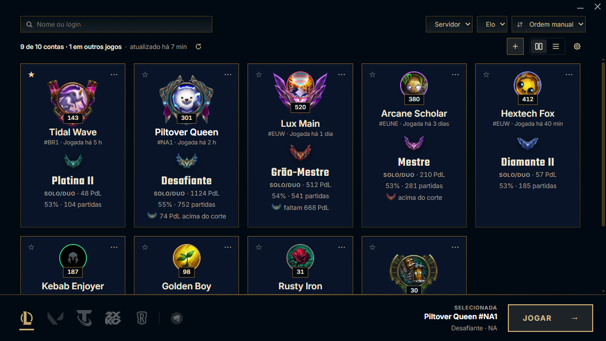
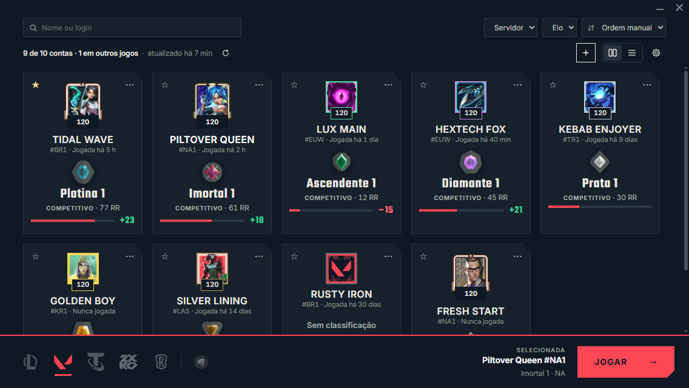
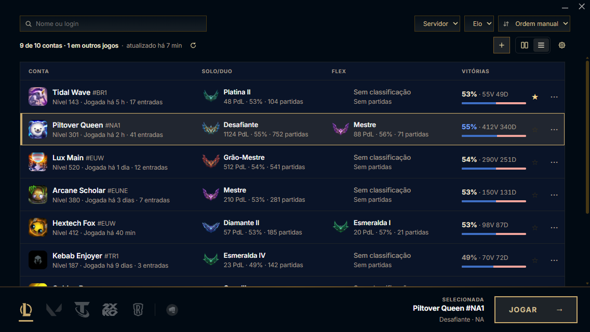

<div align="center">


# Eclipse

**Todas as suas contas da Riot, um clique de distância.**

Gerenciador de contas que vive dentro do Riot Client: escolha a conta, clique em Jogar e o Eclipse entra e abre o jogo.

[](https://github.com/arthurmchd/riot-account-manager/releases/latest)
[](https://github.com/arthurmchd/riot-account-manager/releases)
[](#baixar-e-instalar)
[](https://tauri.app)
[](https://www.rust-lang.org)

[**Baixar**](https://github.com/arthurmchd/riot-account-manager/releases/latest) · [Recursos](#recursos) · [Como funciona](#como-funciona) · [Segurança](#segurança-e-privacidade) · [Perguntas frequentes](#perguntas-frequentes)



</div>

## Recursos

**Entrar sem digitar**
- Um clique em **Jogar** entra na conta e abre o jogo; a janela da Riot fecha sozinha quando o jogo aparece.
- Na primeira vez, o Eclipse preenche o login da própria Riot. Depois, com **Manter login**, entra em segundo plano com a sessão guardada daquela conta.
- 2FA, CAPTCHA e termos de uso continuam na tela da Riot, com você.

**Ver tudo de uma vez**
- League of Legends, VALORANT, Teamfight Tactics, 2XKO e Legends of Runeterra, cada um na sua aba, além de só entrar no Riot Client.
- Elo, PdL ou RR, winrate, partidas e nível de cada conta, atualizados sozinhos. Sem precisar de chave de API.
- A borda e o ícone que você usa no jogo aparecem na placa da conta.

**Organizar muitas contas**
- Busca, filtros por servidor e elo, favoritas fixadas no topo e ordem manual arrastando.
- Placas grandes ou lista compacta, como preferir.
- Cadastro de várias contas de uma vez.

**Com a cara da Riot**
- Tema escuro do Riot Client, com o visual de cada jogo: dourado no League, vermelho e cantos cortados no VALORANT.
- Animações e sons de interface do cliente do League (dá para desligar).
- Português e inglês.

**No seu Windows**
- Fica na bandeja, abre junto com o Windows se você quiser e avisa por notificação.
- Instala sem pedir administrador e se atualiza por cima, sem perder contas.

<table>
  <tr>
    <td></td>
    <td></td>
  </tr>
  <tr>
    <td align="center"><sub>Aba do VALORANT</sub></td>
    <td align="center"><sub>Lista compacta</sub></td>
  </tr>
</table>

<sub>Capturas com contas fictícias.</sub>

## Baixar e instalar

1. Baixe o `Eclipse_<versão>_x64-setup.exe` da [versão mais recente](https://github.com/arthurmchd/riot-account-manager/releases/latest).
2. Rode o arquivo. Ele instala na sua conta do Windows, sem pedir administrador, e cria o atalho **Eclipse** no menu Iniciar.
3. Abra o Eclipse e depois o Riot Client, pelo atalho de sempre. As contas aparecem dentro da janela da Riot.

> [!NOTE]
> O instalador ainda não é assinado digitalmente. Se o Windows mostrar "O Windows protegeu o computador", clique em **Mais informações** → **Executar assim mesmo**. Cada versão traz o SHA-256 do instalador nas notas, para você conferir com `Get-FileHash`.

**Requisitos:** Windows 10 ou 11, 64 bits, com o Riot Client instalado.

**Atualizar:** saia do Eclipse pela bandeja e rode o instalador novo por cima. Contas, sessões e configurações continuam.

**Desinstalar:** em **Configurações → Aplicativos instalados** do Windows.

## Como funciona

O Eclipse acompanha a janela do Riot Client e mostra as contas sobre a arte, ao lado do login. Ele fala com o Riot Client pelo serviço local que a própria Riot usa, no seu computador.

| Etapa | O que acontece |
|---|---|
| Primeira entrada da conta | O Eclipse preenche usuário e senha no formulário da Riot. Verificações aparecem para você ali mesmo. |
| Próximas entradas | Com **Manter login**, a Riot recebe de volta a sessão que ela mesma guardou para aquela conta, sem formulário. |
| Trocar de conta | A Riot fecha com a saída normal e abre na conta escolhida. A sessão de quem saiu continua valendo. |
| Elos | League pelo OP.GG; League, TFT e VALORANT também lidos do jogo aberto quando a conta joga. |

## Segurança e privacidade

- **Tudo fica no seu computador.** Senhas e sessões são criptografadas com a proteção de dados do Windows (DPAPI), atrelada à sua conta do Windows.
- **Nada é contornado.** O Eclipse não burla CAPTCHA, 2FA ou qualquer verificação da Riot.
- **Os jogos não são tocados.** O Eclipse não altera a instalação da Riot, não injeta código e não mexe nos jogos nem no Vanguard.
- **Rede fechada.** O Eclipse não abre portas no seu PC e só conversa com o Riot Client local por conexão verificada.
- **Serviços externos, com transparência.** O Riot ID e o servidor de cada conta vão ao OP.GG para buscar o elo do League. Ícones, emblemas e sons vêm da CommunityDragon. Senha e sessão nunca saem do seu computador.

## Perguntas frequentes

<details>
<summary><b>Posso ser banido por usar o Eclipse?</b></summary>
<br>
O Eclipse usa só o próprio Riot Client: preenche o login da Riot e devolve a ela a sessão do "Manter login". Ele não lê nem altera a memória dos jogos e não interage com o Vanguard. Ainda assim, é um projeto não oficial, e a Riot não se manifestou sobre ele. Use por sua conta.
</details>

<details>
<summary><b>Preciso de chave de API da Riot?</b></summary>
<br>
Não. O elo do League vem do OP.GG, e o do VALORANT e do TFT aparece quando a conta joga com o Eclipse aberto.
</details>

<details>
<summary><b>A Riot pediu código de verificação. E agora?</b></summary>
<br>
Digite o código na própria tela da Riot, como sempre. Depois disso, com <b>Manter login</b> ligado, as próximas entradas daquela conta não pedem nada até a sessão expirar.
</details>

<details>
<summary><b>Por que uma conta voltou a pedir senha?</b></summary>
<br>
A sessão guardada deixa de valer quando você sai da conta pelo menu da Riot ou usa <b>Sign Out</b> no LoL. Para fechar o jogo, use <b>Exit</b>. Trocar a senha ou sair de todos os dispositivos também encerra a sessão.
</details>

<details>
<summary><b>Funciona no macOS ou no Linux?</b></summary>
<br>
Não. O Eclipse é só para Windows, como o Vanguard.
</details>

## Para desenvolvedores

Requisitos: Rust com `tauri-cli` (`cargo install tauri-cli`) e Node.js 22 ou mais novo.

```powershell
npm ci
cd src-tauri
cargo tauri build
```

O instalador sai em `src-tauri\target\release\bundle\nsis\`. Em desenvolvimento, o app só abre com uma pasta de dados de teste, para nunca tocar nas contas reais:

```powershell
$env:ECLIPSE_DATA_DIR = "C:\pasta\de\teste"
cd src-tauri
cargo run
```

| Comando | O que faz |
|---|---|
| `cargo test` (em `src-tauri/`) | Testes do app |
| `npm test` | Testes da interface |
| `npm run preview` | Interface no navegador com contas fictícias, em <http://localhost:5178> |
| `cargo tauri build` (em `src-tauri/`) | Gera o instalador |

```
src-tauri/           app em Rust e Tauri, instalador e testes
  src/application/   armazenamento, login, sessões e elos
  src/riot/          Riot Client e fluxo de login
  src/platform/      janelas, criptografia, bandeja e notificações
  src/integration/   sobreposição na janela da Riot
src/renderer/        interface das contas
docs/                documentação (vault do Obsidian)
```

A documentação completa, com arquitetura, decisões e o porquê de cada regra, fica em [`docs/`](docs/00%20Início.md). Comece por [Visão geral](docs/01%20Visão%20geral/Visão%20geral.md), [Arquitetura](docs/02%20Arquitetura/Arquitetura.md) e [Segurança e privacidade](docs/02%20Arquitetura/Segurança%20e%20privacidade.md).

## Aviso legal

O Eclipse não é endossado pela Riot Games e não reflete as opiniões da Riot Games nem de ninguém envolvido oficialmente na produção ou no gerenciamento das propriedades da Riot Games. Riot Games, League of Legends, VALORANT, Teamfight Tactics, 2XKO e Legends of Runeterra são marcas ou marcas registradas da Riot Games, Inc.
