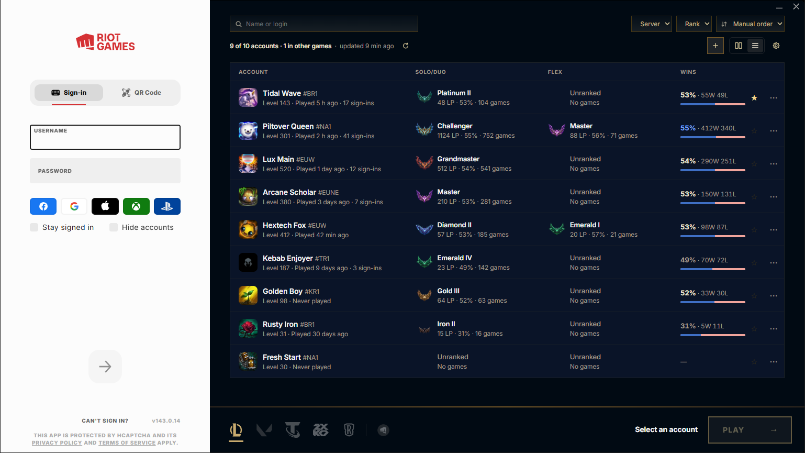

<div align="center">


# Eclipse

**Every Riot account you own, one click away.**

An account manager that lives inside the Riot Client: pick an account, hit Play, and Eclipse signs in and launches the game.

[](https://github.com/arthurmchd/eclipse/releases/latest)
[](https://github.com/arthurmchd/eclipse/releases)
[](#download-and-install)
[](https://tauri.app)
[](https://www.rust-lang.org)

[**Download**](https://github.com/arthurmchd/eclipse/releases/latest) · [Features](#features) · [How it works](#how-it-works) · [Security](#security-and-privacy) · [FAQ](#faq)


<sub>Eclipse inside the Riot Client: sign in on the left, your accounts on the right.</sub>

</div>

## Features

**Sign in without typing**
- One click on **Play** signs in and launches the game; the Riot window closes on its own once the game shows up.
- The first time, Eclipse fills in Riot's own sign-in form. After that, with **Stay signed in**, it signs in in the background using the session saved for that account.
- 2FA, CAPTCHA and terms of service stay on Riot's screen, in your hands.

**See everything at a glance**
- League of Legends, VALORANT, Teamfight Tactics, 2XKO and Legends of Runeterra, each in its own tab, plus a plain Riot Client sign-in.
- Rank, LP or RR, win rate, games played and level for every account, refreshed automatically. No API key needed.
- The border and icon you use in game show up on the account's card.

**Organize lots of accounts**
- Search, filters by server and rank, favorites pinned to the top and a manual order you set by dragging.
- Large cards or a compact list, whichever you prefer.
- Add many accounts at once.

**Looks like Riot**
- The Riot Client's dark theme, styled after each game: gold in League, red with cut corners in VALORANT.
- Motion and interface sounds from the League client (you can turn the sounds off).
- English and Portuguese.

**Made for Windows**
- Lives in the system tray, can start with Windows and lets you know through notifications.
- Installs without admin rights and updates in place without losing your accounts.

<table>
  <tr>
    <td></td>
    <td></td>
  </tr>
  <tr>
    <td align="center"><sub>VALORANT tab</sub></td>
    <td align="center"><sub>Compact list</sub></td>
  </tr>
</table>

<sub>Screenshots use made-up accounts.</sub>

## Download and install

1. Download `Eclipse_<version>_x64-setup.exe` from the [latest release](https://github.com/arthurmchd/eclipse/releases/latest).
2. Run it. It installs for your Windows user, without admin rights, and adds an **Eclipse** shortcut to the Start menu.
3. Open Eclipse, then open the Riot Client the way you always do. Your accounts appear inside the Riot window.

> [!NOTE]
> The installer is not code-signed yet. If Windows shows "Windows protected your PC", click **More info** → **Run anyway**. Every release lists the installer's SHA-256 so you can check it with `Get-FileHash`.

**Requirements:** 64-bit Windows 10 or 11 with the Riot Client installed.

**Updating:** quit Eclipse from the tray and run the new installer over the old one. Accounts, sessions and settings are kept.

**Uninstalling:** from Windows **Settings → Installed apps**.

## How it works

Eclipse follows the Riot Client window and shows your accounts over the artwork, next to the sign-in form. It talks to the Riot Client through the same local service Riot itself uses, on your own computer.

| Step | What happens |
|---|---|
| First sign-in for an account | Eclipse fills in username and password on Riot's form. Any verification shows up for you right there. |
| Later sign-ins | With **Stay signed in**, Riot gets back the session it saved for that account itself, with no form at all. |
| Switching accounts | Riot quits the normal way and reopens on the account you picked. The previous account's session stays valid. |
| Ranks | League from OP.GG; League, TFT and VALORANT are also read from the open game whenever the account plays. |

## Security and privacy

- **Everything stays on your computer.** Passwords and sessions are encrypted with Windows Data Protection (DPAPI), tied to your Windows user.
- **Nothing is bypassed.** Eclipse never works around CAPTCHA, 2FA or any other Riot verification.
- **Games are left alone.** Eclipse does not modify the Riot installation, does not inject code and never touches the games or Vanguard.
- **No open ports.** Eclipse opens no network ports on your PC and only talks to the local Riot Client over a verified connection.
- **External services, stated plainly.** Each account's Riot ID and server go to OP.GG to look up League ranks. Icons, emblems and sounds come from CommunityDragon. Passwords and sessions never leave your computer.

## FAQ

<details>
<summary><b>Can I get banned for using Eclipse?</b></summary>
<br>
Eclipse only uses the Riot Client itself: it fills in Riot's sign-in form and hands back the "Stay signed in" session Riot saved. It doesn't read or change game memory and doesn't interact with Vanguard. Still, it's an unofficial project and Riot hasn't commented on it. Use it at your own risk.
</details>

<details>
<summary><b>Do I need a Riot API key?</b></summary>
<br>
No. League ranks come from OP.GG, and VALORANT and TFT ranks show up once the account plays with Eclipse open.
</details>

<details>
<summary><b>Riot asked for a verification code. What now?</b></summary>
<br>
Type the code on Riot's own screen, as usual. After that, with <b>Stay signed in</b> on, that account won't ask again until its session expires.
</details>

<details>
<summary><b>Why is an account asking for its password again?</b></summary>
<br>
A saved session stops working when you sign out from the Riot menu or use <b>Sign Out</b> in League. To close the game, use <b>Exit</b>. Changing the password or signing out of all devices also ends the session.
</details>

<details>
<summary><b>Does it work on macOS or Linux?</b></summary>
<br>
No. Eclipse is Windows only, just like Vanguard.
</details>

## For developers

Requirements: Rust with `tauri-cli` (`cargo install tauri-cli`) and Node.js 22 or newer.

```powershell
npm ci
cd src-tauri
cargo tauri build
```

The installer ends up in `src-tauri\target\release\bundle\nsis\`. In development the app only starts with a test data folder, so it can never touch real accounts:

```powershell
$env:ECLIPSE_DATA_DIR = "C:\path\to\test\data"
cd src-tauri
cargo run
```

| Command | What it does |
|---|---|
| `cargo test` (in `src-tauri/`) | App tests |
| `npm test` | Interface tests |
| `npm run preview` | Interface in the browser with made-up accounts, at <http://localhost:5178> |
| `cargo tauri build` (in `src-tauri/`) | Builds the installer |

```
src-tauri/           Rust and Tauri app, installer and tests
  src/application/   storage, sign-in, sessions and ranks
  src/riot/          Riot Client control and sign-in flow
  src/platform/      windows, encryption, tray and notifications
  src/integration/   overlay attached to the Riot window
src/renderer/        account interface
docs/                documentation (Obsidian vault, in Portuguese)
```

The full documentation, with architecture, decisions and the reasoning behind every rule, lives in [`docs/`](docs/00%20Início.md), written in Portuguese. Good starting points: [Overview](docs/01%20Visão%20geral/Visão%20geral.md), [Architecture](docs/02%20Arquitetura/Arquitetura.md) and [Security and privacy](docs/02%20Arquitetura/Segurança%20e%20privacidade.md).

## Legal

Eclipse isn't endorsed by Riot Games and doesn't reflect the views or opinions of Riot Games or anyone officially involved in producing or managing Riot Games properties. Riot Games, League of Legends, VALORANT, Teamfight Tactics, 2XKO and Legends of Runeterra are trademarks or registered trademarks of Riot Games, Inc.
