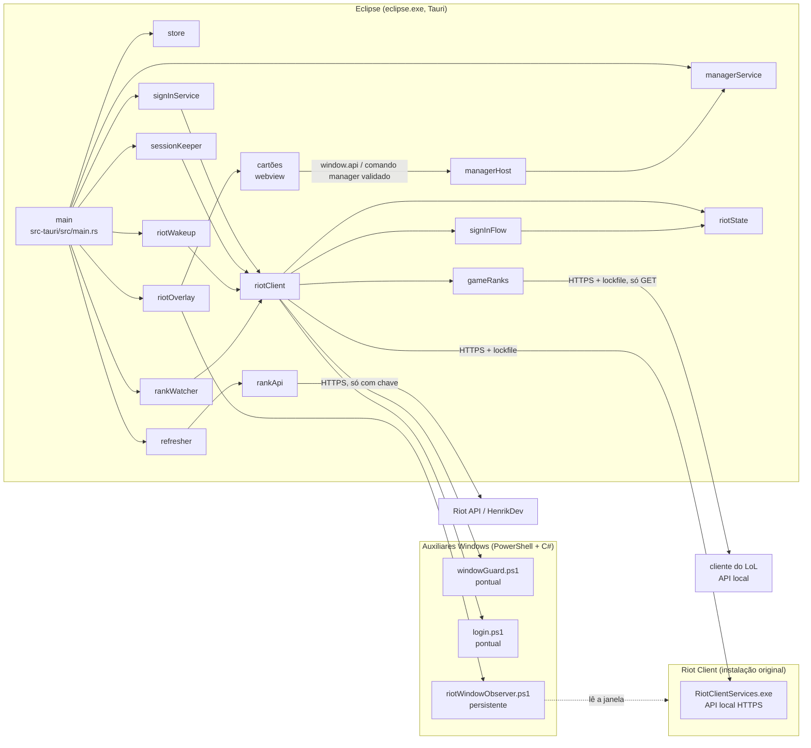
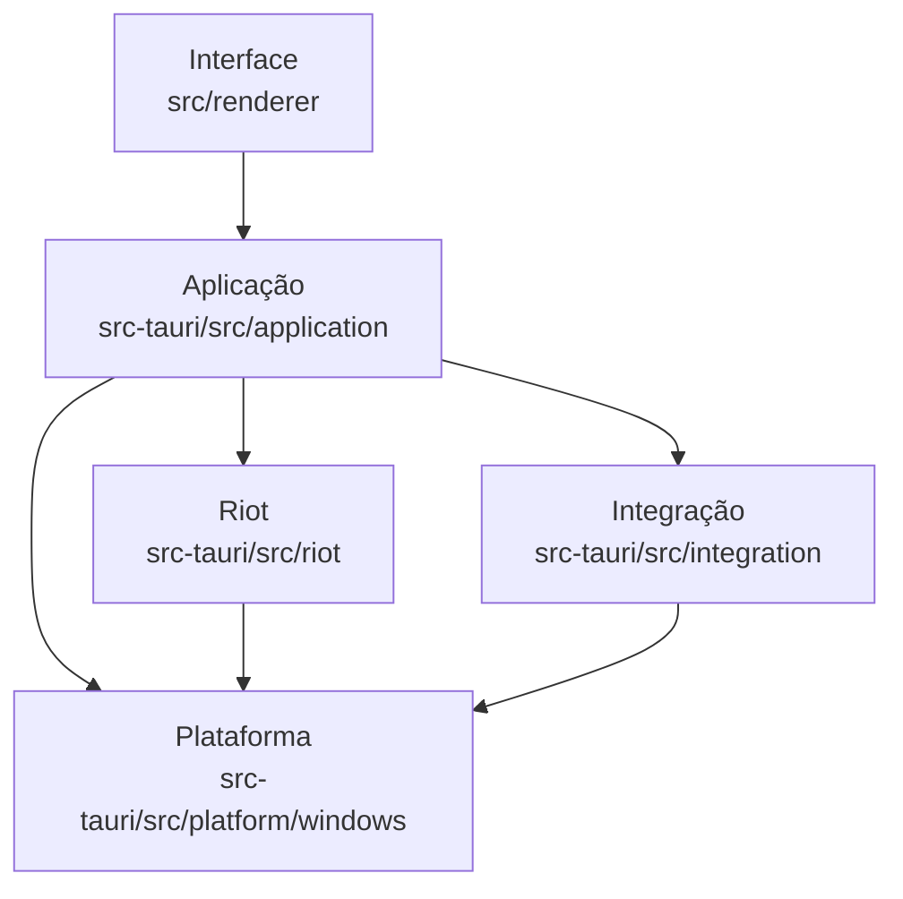

# Arquitetura

> Só Tauri e Rust desde a versão 2.0.0, em 2026-11-15 ([[ADR-034 Troca do Electron pelo Tauri]]). A migração está em [[Migração para Tauri]], e o Electron, na tag `electron-final`.

App Tauri com um processo só: a lógica, os segredos persistidos e o controle da Riot ficam no `eclipse.exe`, em Rust. A interface são os [[cards]], uma webview do WebView2 numa janela transparente presa à janela oficial da Riot ([[Integração com o Riot Client]]). Não existe janela independente do gerenciador nem cópia da interface da Riot ([[ADR-028 Modo antigo removido]]).

## Processos

| Processo | Vida | Recebe segredos? |
|---|---|---|
| Eclipse (`eclipse.exe`) | Enquanto o app roda; mantém a bandeja e o armazenamento | Sim: decripta a senha para o login |
| Cartões (webview `cards`) | Enquanto a sobreposição existe; visível só na tela de login | Não recebe segredos persistidos; só o que o usuário digita nos formulários |
| `riotWindowObserver.ps1` | Um helper persistente enquanto o app roda | Não |
| `windowGuard.ps1` | Uma execução por pedido: trazer a Riot à frente, fechar a janela dela, procurar o jogo | Não |
| `login.ps1` | Uma execução por preenchimento de compatibilidade | Sim, por stdin, nunca por argumento |

O WebView2 roda os próprios processos de navegador, que o Windows gerencia; eles só veem as páginas da lista fechada do [[assetProtocol]].

## Camadas

- **Interface** exibe e pede. Nada de regra de negócio.
- **Aplicação** orquestra: armazenamento, agendamento de elos, serviços de gerenciamento, login e sessão. O `main.rs` monta as peças e a bandeja.
- **Riot** fala com o Riot Client: processos, arquivo de configurações, API local, autenticação e o fluxo de login.
- **Integração** cuida da sobreposição sobre a janela da Riot, da webview dos cartões e do comando validado, e lê o lockfile e o certificado da Riot ([[backend]], [[asar]]).
- **Plataforma** isola o que é específico do Windows: janelas, `LocalAppData`, DPAPI, notificações e a entrada de início com o Windows ([[startWithWindows]]).

A regra de dependência aponta para baixo. `src-tauri/src/paths.rs` é o único lugar que conhece o layout de pastas ([[paths]]).

## Princípios

1. **Um dono para cada operação.** [[signInService]] é o único que inicia logins. Operações concorrentes são recusadas.
2. **Dependências por trait em tudo que toca o mundo.** `SignInIo`, `LocalApi`, `HelperRunner`, `Timers`: os testes trocam processos, rede, disco e tempo por dublês.
3. **Segredos não atravessam fronteiras.** Ver [[Segurança e privacidade]].
4. **Falhar fechado.** Estado de login desconhecido ou consulta falha: esconder os cartões, nunca adivinhar.
5. **Nunca alterar a Riot.** Nenhum arquivo da instalação é escrito; o `app.asar` oficial só é lido.
6. **Páginas sem build.** Os cartões rodam direto do HTML com ES modules; só o Rust é compilado ([[Desenvolvimento]]).

## Comunicação

| De → Para | Canal | Nota |
|---|---|---|
| cartões → serviço de contas | `window.api` pelo comando `manager`, validado no Rust | [[manager-preload]], [[managerHost]], [[managerService]] |
| Eclipse → cartões | Consulta à fila limitada de eventos públicos | [[managerService]], [[manager-preload]] |
| caixa "Ocultar contas" → Eclipse | comando `overlay_toggle`, só um booleano | [[overlayToggle]] |
| Eclipse → Riot Client | HTTPS na porta do lockfile, CA lida do `app.asar` oficial | [[riotTransport]], [[backend]], [[asar]] |
| sobreposição → janela da Riot | helper persistente, stdin/stdout JSON | [[riotWindowObserver]] |
| Eclipse → janelas da Riot e do jogo | stdin JSON para `windowGuard.ps1`, um processo por pedido | [[windowController]] |

## Leitura complementar

- [[Fluxo de login]]
- [[Integração com o Riot Client]]
- [[Estrutura de pastas]]
