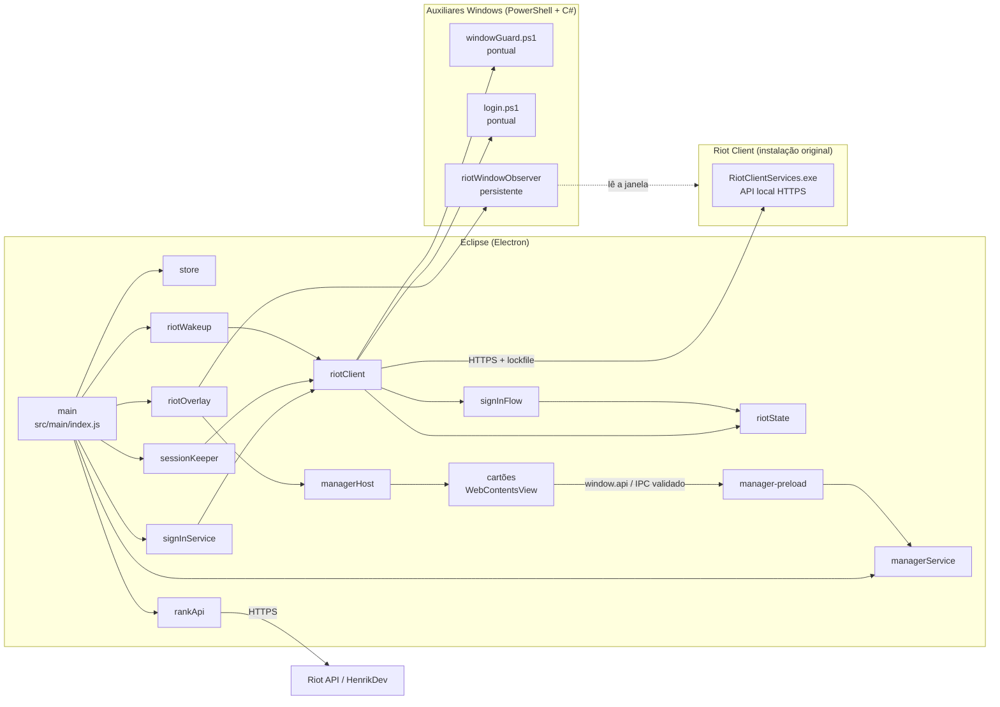
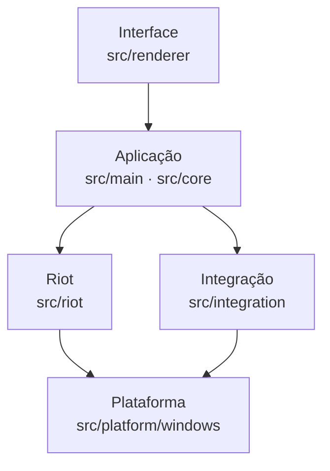

# Arquitetura

App Electron com um processo de serviços em segundo plano: a lógica, os segredos persistidos e o controle do Riot ficam no main. A interface são os [[cards]], uma `WebContentsView` numa janela transparente presa à janela oficial da Riot ([[Integração com o Riot Client]]). Não existe janela independente do gerenciador nem cópia da interface da Riot ([[ADR-028 Modo antigo removido]]).

## Processos

| Processo | Vida | Recebe segredos? |
|---|---|---|
| Serviços (main) | Enquanto o app roda; mantém a bandeja e o armazenamento | Sim: decripta a senha para o login |
| Cartões (`WebContentsView`) | Enquanto a sobreposição existe; visível só na tela de login | Não recebe segredos persistidos; só o que o usuário digita nos formulários |
| `riotWindowObserver` | Um helper persistente enquanto o app roda | Não |
| `windowGuard.ps1` | Uma execução por pedido: trazer a Riot à frente, fechar a janela dela, procurar o jogo | Não |
| `login.ps1` | Uma execução por preenchimento de compatibilidade | Sim, por stdin, nunca por argumento |

## Camadas

- **Interface** exibe e pede. Nada de regra de negócio.
- **Aplicação** orquestra: bandeja, agendamento de elos, armazenamento e serviços de gerenciamento, login e sessão.
- **Riot** fala com o Riot Client: processos, arquivo de configurações, API local, autenticação e o fluxo de login.
- **Integração** cuida da sobreposição sobre a janela da Riot, da view dos cartões e do IPC validado, e lê o lockfile e o certificado da Riot ([[backend]], [[asar]]).
- **Plataforma** isola o que é específico do Windows: janelas e `LocalAppData`.

A regra de dependência aponta para baixo. `src/paths.js` é o único lugar que conhece o layout de pastas ([[paths]]).

## Princípios

1. **Um dono para cada operação.** [[signInService]] é o único que inicia logins. Operações concorrentes são recusadas.
2. **Injeção de dependência em tudo que toca o mundo.** `createSignInFlow(io)`, `createRiotTransport({ request })`, `createWindowController({ spawn })`: os testes trocam processos, rede e disco por dublês.
3. **Segredos não atravessam fronteiras.** Ver [[Segurança e privacidade]].
4. **Falhar fechado.** Estado de login desconhecido ou consulta falha: esconder os cartões, nunca adivinhar.
5. **Nunca alterar a Riot.** Nenhum arquivo da instalação é escrito; o `app.asar` oficial só é lido.
6. **Nada de build.** O renderer roda direto do HTML com ES modules. O empacotamento ainda não existe ([[Backlog]]).

## Comunicação

| De → Para | Canal | Nota |
|---|---|---|
| cartões → serviço de contas | `window.api` pelo IPC dedicado e validado | [[manager-preload]], [[managerHost]], [[managerService]] |
| serviços → cartões | Consulta à fila limitada de eventos públicos | [[managerService]], [[manager-preload]] |
| main → Riot Client | HTTPS na porta do lockfile, CA lida do `app.asar` oficial | [[riotTransport]], [[backend]], [[asar]] |
| sobreposição → janela da Riot | helper persistente, stdin/stdout JSON | [[riotWindowObserver]] |
| main → janelas da Riot e do jogo | stdin JSON para `windowGuard.ps1`, um processo por pedido | [[windowController]] |

## Leitura complementar

- [[Fluxo de login]]
- [[Integração com o Riot Client]]
- [[Estrutura de pastas]]
