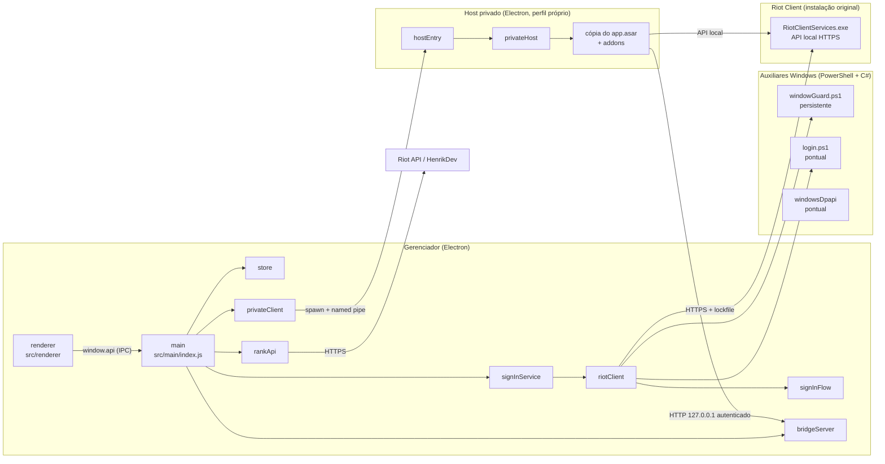
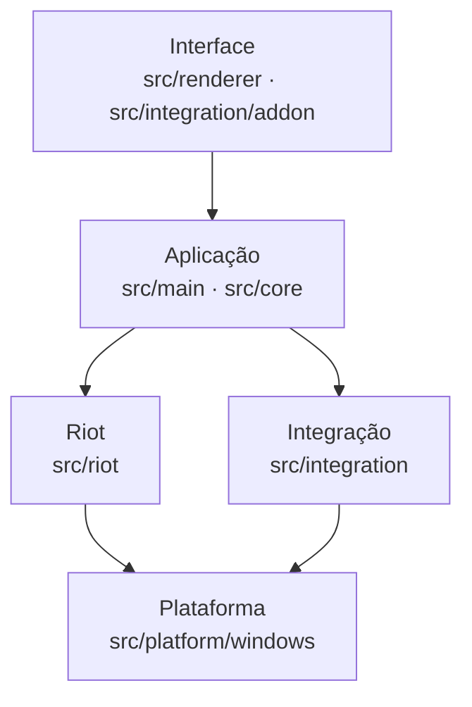

# Arquitetura

App Electron de processo principal "gordo": toda a lógica, os segredos e o controle do Riot ficam no main process. As interfaces (a janela do gerenciador e o painel dentro do login Riot) só pedem ações e exibem estado.

## Processos

| Processo | Vida | Recebe segredos? |
|---|---|---|
| Gerenciador (main) | Enquanto o app roda; fica na bandeja no modo integrado | Sim: decripta senha só durante o login |
| Renderer do gerenciador | Janela aberta | Nunca recebe senha nem token |
| `windowGuard.ps1` | Uma instância persistente por sessão de jogo | Não |
| `login.ps1` | Uma execução por preenchimento de compatibilidade | Sim, por stdin, nunca por argumento |
| Host privado | Enquanto a tela de login integrada existe | Token do backend Riot, criptografado com DPAPI |
| Painel (addons) | Dentro do host privado | Não: envia só `accountId` e o jogo |

## Camadas

- **Interface** exibe e pede. Nada de regra de negócio.
- **Aplicação** orquestra: IPC, bandeja, agendamento de elos, armazenamento e o serviço de login compartilhado.
- **Riot** fala com o Riot Client: processos, arquivo de configurações, API local, autenticação e o fluxo de login.
- **Integração** cuida da cópia privada da interface do Riot e da ponte local com o painel.
- **Plataforma** isola o que é específico do Windows: janelas, DPAPI, `LocalAppData`.

A regra de dependência aponta para baixo. `src/paths.js` é o único lugar que conhece o layout de pastas ([[paths]]).

## Princípios

1. **Um dono para cada operação.** [[signInService]] é o único que inicia logins, para a janela e para o painel. Operações concorrentes são recusadas.
2. **Injeção de dependência em tudo que toca o mundo.** `createSignInFlow(io)`, `createRiotTransport({ request })`, `createWindowController({ spawn })`: os testes trocam processos, rede e disco por dublês.
3. **Segredos não atravessam fronteiras.** Ver [[Segurança e privacidade]].
4. **Falhar fechado.** Versão do Riot desconhecida, manifesto inválido ou hash diferente: recusar e mostrar mensagem, nunca abrir o cliente original em silêncio.
5. **Nada de build.** O renderer roda direto do HTML com ES modules. O empacotamento ainda não existe ([[Backlog]]).

## Comunicação

| De → Para | Canal | Nota |
|---|---|---|
| renderer → main | `ipcRenderer.invoke` via `window.api` | [[preload]] |
| main → renderer | `webContents.send` (`account-updated`, `sign-in-operation`…) | [[main]] |
| main → Riot Client | HTTPS na porta do lockfile, CA embutida do Riot | [[riotTransport]], [[backend]] |
| main → janelas Riot | stdin JSON para `windowGuard.ps1` | [[windowController]] |
| main → host privado | named pipe aleatório | [[bootstrapChannel]], [[privateClient]] |
| painel → main | HTTP em `127.0.0.1` com token | [[bridgeServer]], [[addons]] |

## Leitura complementar

- [[Fluxo de login]]
- [[Integração com o Riot Client]]
- [[Estrutura de pastas]]
