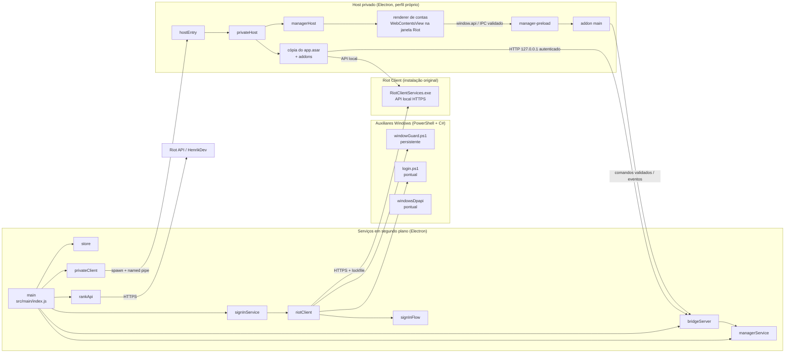
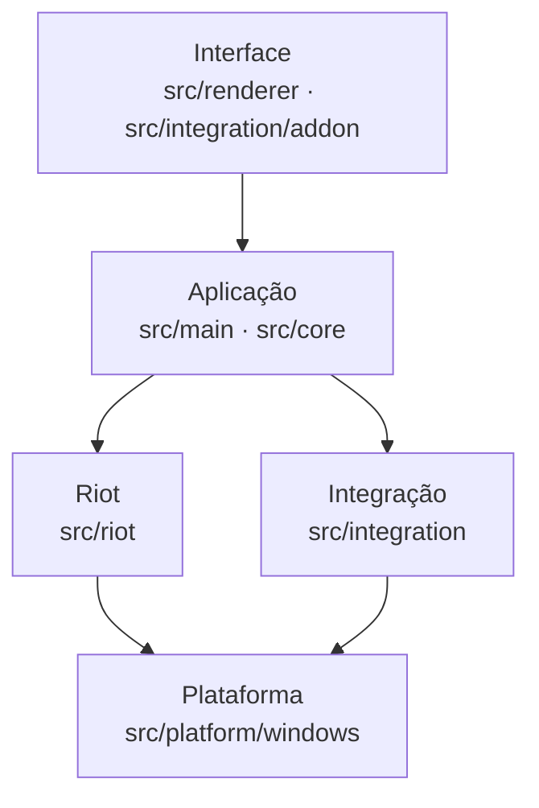

# Arquitetura

App Electron com um processo de serviços em segundo plano: a lógica, os segredos persistidos e o controle do Riot ficam no main. A interface completa de contas é um `WebContentsView` dentro da mesma janela da cópia privada do Riot; não existe mais uma `BrowserWindow` independente do gerenciador. O seletor rápido e a visualização completa pedem ações e exibem estado, conforme [[ADR-007 Interface completa dentro do Riot Client]].

## Processos

| Processo | Vida | Recebe segredos? |
|---|---|---|
| Serviços (main) | Enquanto o app roda; mantém a bandeja e o armazenamento | Sim: decripta senha para login ou cópia |
| Visualização de contas | Enquanto o `WebContentsView` está aberto na janela Riot | Não recebe segredos persistidos; recebe somente valores que o usuário digita nos formulários |
| `windowGuard.ps1` | Uma instância persistente por sessão de jogo | Não |
| `login.ps1` | Uma execução por preenchimento de compatibilidade | Sim, por stdin, nunca por argumento |
| Host privado | Enquanto a interface Riot integrada existe | Token do backend Riot, recebido criptografado por DPAPI; addon main decifra o token da ponte |
| Seletor rápido (addon renderer) | No formulário de login, com acesso Contas disponível também na página conectada | Não recebe senhas salvas: envia `accountId` e jogo |

## Camadas

- **Interface** exibe e pede. Nada de regra de negócio.
- **Aplicação** orquestra: bandeja, agendamento de elos, armazenamento e serviços de gerenciamento e login.
- **Riot** fala com o Riot Client: processos, arquivo de configurações, API local, autenticação e o fluxo de login.
- **Integração** cuida da cópia privada, da visualização de contas na janela Riot, do IPC validado e da ponte local.
- **Plataforma** isola o que é específico do Windows: janelas, DPAPI, `LocalAppData`.

A regra de dependência aponta para baixo. `src/paths.js` é o único lugar que conhece o layout de pastas ([[paths]]).

## Princípios

1. **Um dono para cada operação.** [[signInService]] é o único que inicia logins, para a visualização completa e para o seletor rápido. Operações concorrentes são recusadas.
2. **Injeção de dependência em tudo que toca o mundo.** `createSignInFlow(io)`, `createRiotTransport({ request })`, `createWindowController({ spawn })`: os testes trocam processos, rede e disco por dublês.
3. **Segredos não atravessam fronteiras.** Ver [[Segurança e privacidade]].
4. **Falhar fechado.** Versão do Riot desconhecida, manifesto inválido ou hash diferente: recusar e mostrar mensagem, nunca abrir o cliente original em silêncio.
5. **Nada de build.** O renderer roda direto do HTML com ES modules. O empacotamento ainda não existe ([[Backlog]]).

## Comunicação

| De → Para | Canal | Nota |
|---|---|---|
| visualização de contas → host privado | `window.api` pelo IPC dedicado e validado | [[manager-preload]], [[managerHost]] |
| host privado → serviço de contas | Ponte autenticada; métodos e argumentos limitados | [[addons]], [[bridgeServer]], [[managerService]] |
| serviços → visualização de contas | Consulta à fila limitada de eventos públicos | [[managerService]], [[manager-preload]] |
| main → Riot Client | HTTPS na porta do lockfile, CA embutida do Riot | [[riotTransport]], [[backend]] |
| main → janelas Riot | stdin JSON para `windowGuard.ps1` | [[windowController]] |
| main → host privado | named pipe aleatório | [[bootstrapChannel]], [[privateClient]] |
| painel → main | HTTP em `127.0.0.1` com token | [[bridgeServer]], [[addons]] |

## Leitura complementar

- [[Fluxo de login]]
- [[Integração com o Riot Client]]
- [[Estrutura de pastas]]
