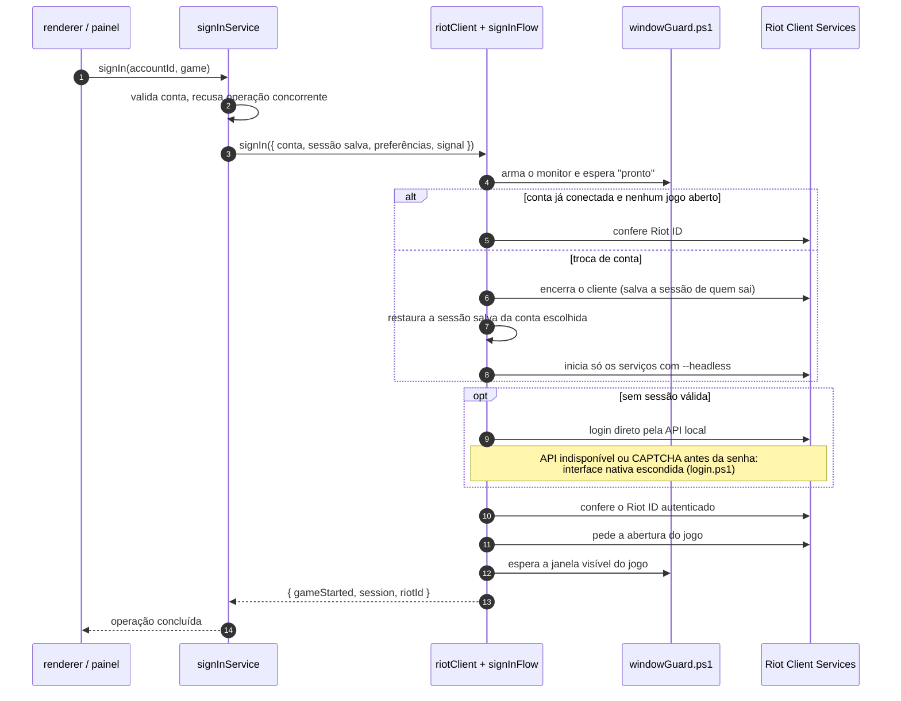

# Fluxo de login

Visão de ponta a ponta do clique em **Play** (ou **Entrar e jogar** no painel integrado) até o jogo aberto. As etapas internas, com cada ramo, estão em [[signInFlow]].

## Etapas para o usuário

1. **Esconde e arma.** Oculta a interface integrada e ativa o monitor de janelas. O painel integrado recusa trocas com jogo aberto; o gerenciador pede confirmação antes de encerrar.
2. **Reaproveita se puder.** Se o Riot ID conectado é o escolhido e nenhum jogo está aberto, usa essa sessão. Se o backend está desconectado e a conta não tem sessão salva, entra nesse mesmo backend, sem reinício.
3. **Troca de sessão.** Guarda a sessão da conta anterior só com identidade confirmada, encerra o cliente e inicia os serviços em `--headless`. A sessão escolhida é carregada depois do encerramento para preservar os tokens atualizados.
4. **Autentica.** Login direto pela API local com HTTPS e o certificado da instalação Riot. Um contexto ausente ou em `invalid_request` é limpo e inicializado antes da primeira submissão de senha. API indisponível ou CAPTCHA antes da senha permitem usar a interface nativa escondida.
5. **Acompanha.** Erros, demora, 2FA ou CAPTCHA não abrem o cliente sozinhos. O painel habilita **Show Riot Client**, que abre a janela do desafio. Depois da autenticação, o monitor volta a ocultá-la.
6. **Abre o jogo.** Só depois de verificar a conta. O sucesso exige uma **janela visível do jogo** (para LoL/TFT, o lobby do League), não apenas um processo.
7. **Mantém oculto.** O monitor continua ativo enquanto o app estiver aberto e esconde janelas recriadas do Riot. Jogos e Vanguard ficam fora do filtro. Ao fechar o app, as janelas voltam ao estado original.

## Regras que não podem quebrar

- Nunca pedir um jogo antes de confirmar o Riot ID ([[signInFlow]]).
- Nunca reenviar a senha depois de falha de senha, rede, limite de tentativas ou CAPTCHA pós-submissão ([[riotAuthentication]]).
- Nunca digitar credenciais sobre um desafio pendente, mesmo que ele expire.
- Nunca associar uma sessão de identidade desconhecida à conta anterior ([[main]], função `saveLeavingSession`).
- Erros comuns não podem revelar a tela de login sozinhos.

Ver também [[Segurança e privacidade]] e [[ADR-003 Sem contornar CAPTCHA ou 2FA]].

## Registro

Cada tentativa vai para `sign-in.log` na pasta de dados, sem usuário nem senha. O texto passa por `safeText` em [[signInService]], que troca usuário e senha por `[redacted]`.
