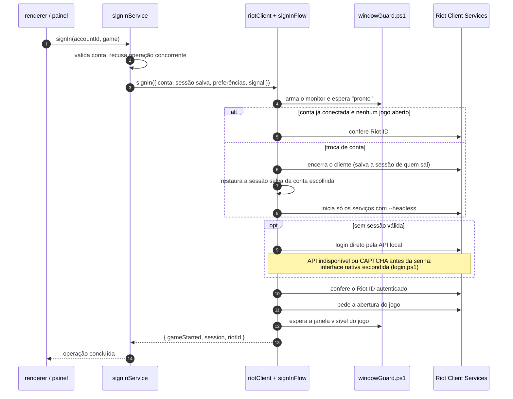

# Fluxo de login

Visão de ponta a ponta do clique em **Play** (ou **Entrar e jogar** no painel integrado) até o jogo aberto. As etapas internas, com cada ramo, estão em [[signInFlow]].

## Etapas para o usuário

1. **Esconde e arma.** Oculta a interface integrada e ativa o monitor de janelas. O painel integrado recusa trocas com jogo aberto; o gerenciador pede confirmação antes de encerrar.
2. **Reaproveita se puder.** Se o Riot ID conectado é o escolhido e nenhum jogo está aberto, usa essa sessão. Se o backend está desconectado e a conta não tem sessão salva, entra nesse mesmo backend, sem reinício.
3. **Troca de sessão.** Guarda a sessão da conta anterior só com identidade confirmada, encerra o cliente e inicia os serviços em `--headless`. A sessão escolhida é carregada depois do encerramento para preservar os tokens atualizados.
4. **Autentica.** Login direto pela API local com HTTPS e o certificado da instalação Riot. Um contexto ausente ou em `invalid_request` é limpo e inicializado antes da primeira submissão de senha. API indisponível ou CAPTCHA antes da senha permitem usar a interface nativa escondida.
5. **Acompanha.** Erros, demora, 2FA ou CAPTCHA não abrem o cliente sozinhos. O painel habilita **Show Riot Client**, que abre a janela do desafio. Depois da autenticação, o monitor volta a ocultá-la.
6. **Abre o jogo.** Só depois de verificar a conta. O sucesso exige uma **janela visível do jogo** (para LoL/TFT, o lobby do League), não apenas um processo.
7. **Mantém oculto.** O monitor continua ativo enquanto o app estiver aberto e esconde janelas recriadas do Riot. Se precisar reiniciar, entrega os snapshots ao substituto sem restaurar a aparência entre eles. Jogos e Vanguard ficam fora do filtro. Ao fechar o app, as janelas voltam ao estado original, inclusive após falha do monitor ([[ADR-008 Recuperação visual sem reexibir o Riot]]).

## Regras que não podem quebrar

- Nunca pedir um jogo antes de confirmar o Riot ID ([[signInFlow]]).
- Nunca reenviar a senha depois de falha de senha, rede, limite de tentativas, rota indisponível ou CAPTCHA pós-submissão ([[riotAuthentication]]).
- Nunca tratar um estado desconhecido da sessão do jogador como autenticado ([[riotAuthentication]]).
- Nunca digitar credenciais sobre um desafio pendente, mesmo que ele expire.
- Nunca associar uma sessão de identidade desconhecida à conta anterior ([[main]], função `saveLeavingSession`).
- Erros comuns não podem revelar a tela de login sozinhos.
- Nunca tirar da Riot um login lembrado de uma conta do Eclipse sem antes guardá-lo na conta dona dele, provada pelo `sub` ou por um Riot ID único ([[sessionKeeper]]).
- Nunca limpar o login lembrado com a Riot conectada: a conta está na memória dela, e o jogo depende disso ([[sessionKeeper]]).
- Nunca sair da conta conectada (`DELETE`) para trocar de conta, em nenhum modo: a saída normal da Riot mantém a sessão dela válida. O `DELETE` só limpa um login pela metade com a Riot sem conta ([[signInFlow]]).

Ver também [[Segurança e privacidade]] e [[ADR-003 Sem contornar CAPTCHA ou 2FA]].

## Modo cartões

O diagrama acima é o modo privado. No modo cartões (padrão), o login é visível desde [[ADR-010 Login visível com progresso]]. Desde [[ADR-024 Coluna de login coberta durante o login]], o formulário fica coberto por um carregamento enquanto o Eclipse o preenche, e a caixa "Ocultar contas" some até o formulário da Riot voltar, também no login manual ([[ADR-025 Caixa some junto com o formulário da Riot]]); 2FA, CAPTCHA ou outro pedido de atenção tira a cobertura. Desde [[ADR-019 Sessão salva por conta no modo cartões]], uma conta com sessão guardada e "Manter login" ligado entra em segundo plano:

1. **Jogar fecha a Riot.** A saída é normal, para a Riot gravar os tokens novos. Depois o Eclipse grava o YAML da conta e sobe só os serviços, sem interface.
2. **Confere e pede o jogo.** Com o Riot ID conferido, pede o jogo. Nenhuma janela precisa de foco e nada é digitado.
3. **Sessão recusada volta ao visível.** Sessão recusada ou de outra conta: fecha a Riot com a saída normal se ela estiver conectada, abre a interface oficial e segue o login visível, como na primeira entrada.
4. **Cada renovação é guardada.** O `refresh_token` é de uso único. Toda vez que a Riot regrava o login de uma conta conhecida, o [[sessionKeeper]] guarda essa versão, mesmo com a Riot aberta. O [[signInFlow]] nunca captura de volta o YAML que ele mesmo restaurou.
5. **A Riot sempre abre desconectada.** Desde [[ADR-021 Riot sempre abre desconectada]], o guardião limpa o login do arquivo assim que a Riot solta a conta. Isso acontece quando:
   - ela fecha;
   - passa ao modo segundo plano depois do jogo;
   - ou volta à tela de login.

   Antes de limpar, guarda o login na conta dona (mesmo `sub`, ou Riot ID único). Login de conta fora do Eclipse é limpo sem ser guardado. Quando o jogo fecha com a Riot ainda conectada (ou ela fica conectada sem janela e sem jogo), o guardião pede a saída normal ([[ADR-020 Riot conectada é encerrada quando fica sem jogo]]). Ela volta a abrir na tela de login, com os cartões, e o usuário nunca precisa sair da conta pela Riot. Se a janela dela estava aberta, o guardião a inicia de novo assim que ela sai e o arquivo fica limpo ([[ADR-026 Riot fechada depois do jogo reabre na tela de login]]).
6. **Saída pela Riot apaga a sessão na hora.** Se a conta sai pela Riot ou pelo "Sign Out" do League, o [[sessionKeeper]] percebe pelo arquivo e pela API e apaga a sessão guardada. O próximo Jogar dela vai direto ao login visível, sem reiniciar a Riot ([[ADR-027 Saída da conta pela Riot apaga a sessão guardada]]).
7. **Trocar de conta não encerra a sessão de quem sai.** O login visível com outra conta conectada fecha a Riot com a saída normal, em vez de `DELETE`, e a sessão de quem sai é guardada na dona provada. Vale também para uma sessão restaurada que se revela de outra conta: a cópia errada é apagada antes, e a sessão renovada vai para a dona dela.

## Registro

Cada tentativa vai para `sign-in.log` na pasta de dados, sem usuário nem senha. O texto passa por `safeText` em [[signInService]], que troca usuário e senha por `[redacted]`.
