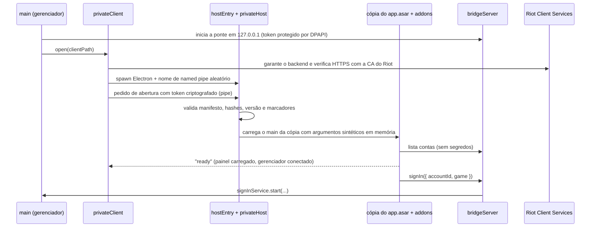

# Integração com o Riot Client

O atalho `Abrir Riot com minhas contas.bat` abre uma **cópia privada** da interface real do Riot Client, hospedada pelo Electron do projeto e conectada aos serviços oficiais locais da Riot. O painel **MINHAS CONTAS** aparece junto do formulário de login. A instalação original do Riot permanece intacta.

Modo experimental para os pacotes de interface **141.0.0 e 142.0.0**. A instalação desta máquina usa o 142.0.0 e exibe **v142.0.1** no rodapé do login. Não é extensão carregada pelo executável original do Riot nem plugin do Rose/Pengu. A decisão está em [[ADR-001 Cópia privada da interface do Riot]].

## Como funciona



Módulos envolvidos: [[privateClient]], [[hostEntry]], [[privateHost]], [[privateHostCore]], [[privateRendererCore]], [[addons]], [[bridgeServer]], [[bootstrapChannel]], [[backend]], [[asar]], [[windowsDpapi]].

## Como usar

1. Após atualizar o código, encerre a instância anterior uma vez (bandeja → **Quit**).
2. Abra `Abrir Riot com minhas contas.bat`.
3. Na tela de login, expanda **MINHAS CONTAS**, escolha a conta e o jogo e pressione **Entrar e jogar**. Cadastre ou edite contas pelo botão **Gerenciar contas**.
4. O gerenciador oculta a interface e faz o login em segundo plano ([[Fluxo de login]]). Quando o jogo abrir, ele será a janela visível.

Se a Riot já estiver conectada, a página inicial dela aparece e o painel fica oculto. Para ver o seletor, saia da sessão pela própria interface. O launcher não desconecta uma sessão só para mostrar o painel.

O gerenciador fica na bandeja: **Open account manager** acompanha a operação, **Open Riot Client** abre a interface, **Cancel sign-in** interrompe, **Quit** encerra.

## Proteção dos dados

- O painel envia só o identificador da conta e o jogo. Senhas e sessões ficam no gerenciador.
- A ponte escuta apenas em `127.0.0.1`, exige token, valida mensagens e limita o tamanho. O token é protegido pelo DPAPI do usuário.
- A inicialização usa um named pipe com nome aleatório. Credenciais de conexão não vão nos argumentos do processo; o token do backend chega criptografado.
- O backend é verificado por HTTPS com o certificado da instalação Riot, com validação de certificado ligada.
- A cópia usa um perfil Chromium próprio dentro do projeto. Os logs do código Riot recebem um filtro que oculta credenciais de conexão.
- No modo integrado o Riot fica sempre oculto, independentemente das preferências antigas do gerenciador.
- Senha incorreta, erro de rede e limite de tentativas não disparam reenvio. O preenchimento nativo só é usado se a API estiver indisponível ou o CAPTCHA vier antes da senha. CAPTCHA depois da submissão pede intervenção, não reenvia.
- Contexto de autenticação ausente ou em erro segue a tela oficial: limpar, inicializar, só então submeter.
- Troca pelo painel é recusada com LoL/TFT/VALORANT abertos. O login é serializado.

Mais em [[Segurança e privacidade]].

## Validação feita

Uma execução real carregou a cópia, confirmou o módulo no renderer e consultou a ponte com lista vazia e autenticação desabilitada. Resultado em `.client-integration/private-v1/probe-controller/result.json`:

```json
{ "ok": true, "rendererReady": true, "managerConnected": true, "mode": "private", "authenticationTested": false }
```

Depois da atualização para 142, o painel apareceu com as contas salvas na tela real de login, sem autenticar. **O fluxo completo com credenciais reais ainda precisa ser validado em uso.**

```powershell
npm run integration:probe-private
npm run preview:riot-login
```

O primeiro repete a verificação de compatibilidade com os serviços Riot abertos, sem login nem jogo. O segundo abre uma demonstração com contas fictícias.

## Atualizações do Riot

O manifesto e os hashes são conferidos antes de carregar a cópia. Uma atualização do Riot invalida a cópia, e o app mostra erro em vez de abrir o cliente original em silêncio. A atualização 142 exigiu adaptar o filtro de logs e a inicialização do protocolo Sentry. A cópia 141 foi preservada em `.client-integration/private-141-backup/`.

O passo a passo para uma versão nova está em [[Atualização do Riot Client]].

> [!warning] Não distribua
> O `app.asar` preparado contém recursos proprietários da Riot. A pasta `.client-integration/` está no `.gitignore` e não pode ir para Releases, ZIPs ou issues.

## Experimento anterior

Foi testada a substituição direta de três entradas do `app.asar` instalado, com backup e hashes. Ao abrir o cliente oficial, a instalação voltou ao pacote original e os módulos sumiram, sem causa identificada. Hash original confirmado: `2c5a8f20b687275fc64936911c883bd92360a794251881e6d74ab045886920fc`.

As ferramentas estão em `scripts/legacy/` e não são usadas pelo atalho. O instalador recusa manifestos da cópia privada. Ver [[Scripts de integração]] e [[status]].
