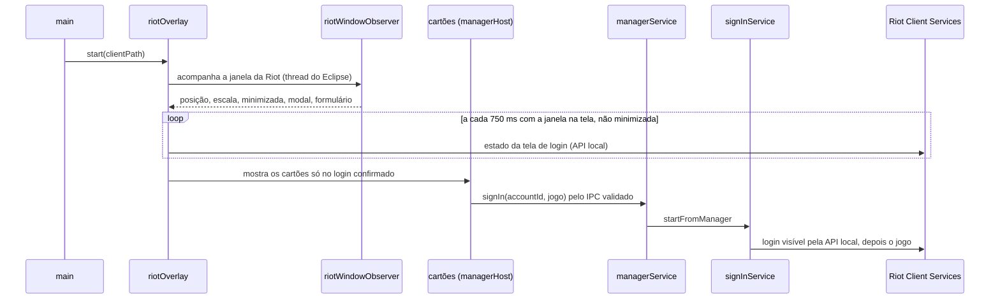

# Integração com o Riot Client

O Eclipse mostra os [[cards]] por cima da janela oficial da Riot, sem alterar nenhum arquivo da instalação. É o único modo desde 2026-11-07 ([[ADR-028 Modo antigo removido]]); a decisão de origem é a [[ADR-009 Sobreposição no cliente oficial]].

O usuário abre a Riot como sempre, pela bandeja ou pelo atalho. Na tela de login, os cartões cobrem a área da arte, à direita da coluna de login. Na coluna fica só a caixa "Ocultar contas" ([[overlayToggle]]).

## Como funciona

- **Janela presa à Riot.** A sobreposição tem a janela da Riot como dona: sobe, desce, minimiza e some junto com ela ([[ADR-012 Sobreposição presa à janela do Riot]]).
- **Só na tela de login.** Os cartões aparecem com o estado `auth` sem erro (ou falha de senha, para tentar de novo). Sessão conectada, 2FA, modal da Riot ou consulta falha escondem os cartões ([[riotOverlay]]).
- **Login visível.** O clique em Jogar faz o login pela API local da Riot, com a coluna de login coberta ([[ADR-024 Coluna de login coberta durante o login]]). Desde a 2.30.0 a coluna mostra as etapas do login, e o Eclipse fica na tela até o jogo abrir ([[ADR-053 Etapas do login na tela até o jogo abrir]]). Detalhes em [[Fluxo de login]].
- **Sessão por conta.** O [[sessionKeeper]] guarda a sessão de cada conta e mantém a Riot sempre desconectada ao abrir ([[ADR-021 Riot sempre abre desconectada]]). O [[riotWakeup]] abre a janela de uma Riot que sai do segundo plano sem uma ([[ADR-023 Riot sem janela abre a interface ao sair do segundo plano]]).

Módulos envolvidos: [[riotOverlay]], [[riotWindowObserver]], [[overlayToggle]], [[overlayCover]], [[managerHost]], [[manager-preload]], [[managerService]], [[signInService]], [[riotClient]], [[riotTransport]], [[backend]], [[asar]].

## Proteção dos dados

- A view dos cartões roda com sandbox e isolamento de contexto. O IPC confere remetente, frame principal e URL local exata ([[managerHost]]).
- A view não recebe senhas, sessões nem chaves salvas. Ela envia só o identificador da conta e o jogo, ou os valores que o usuário digita nos formulários ([[managerService]]).
- O main fala com a Riot por HTTPS na porta do lockfile. O certificado raiz vem do `app.asar` oficial, lido sem alterar nada ([[backend]], [[asar]], [[riotTransport]]).
- O helper de janelas só lê a janela da Riot e repassa minimizar e fechar. Nenhuma credencial passa por ele ([[riotWindowObserver]]).

Mais em [[Segurança e privacidade]].

## Atualizações da Riot

Uma versão nova da Riot pode mudar o layout da tela de login, o modal e a API local. A proporção da coluna de login, os pontos lidos pelo observador e os estados de autenticação são o que mais quebra. O passo a passo está em [[Atualização do Riot Client]].

## Histórico

Até 2026-11-07 existia um segundo modo, `--private-client`: uma cópia modificada da interface da Riot, hospedada por um Electron do projeto ([[ADR-001 Cópia privada da interface do Riot]], [[ADR-007 Interface completa dentro do Riot Client]]). Ele foi removido pela [[ADR-028 Modo antigo removido]]. O código está na tag `modo-antigo-final`, e as notas dos módulos dele ficam em `03 Módulos/Removidos/`.

> [!warning] Pasta antiga
> A pasta `.client-integration/` guardava a cópia preparada. O código não a usa mais. Ela contém recursos proprietários da Riot, continua no `.gitignore` e nunca pode ir para Releases, ZIPs ou issues. O usuário pode apagá-la.
