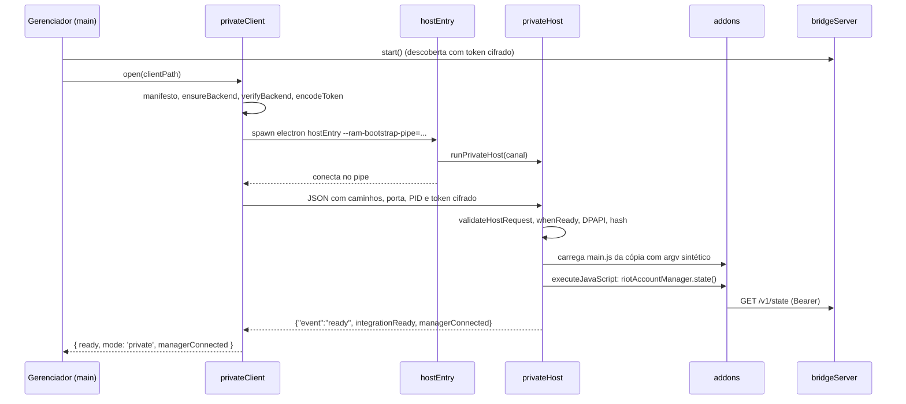

# privateClient

> Controlador, no processo do gerenciador, que verifica a cópia privada, inicia o host privado e envia a ele as credenciais de conexão cifradas.

## Responsabilidade

Confere primeiro o manifesto da cópia em `.client-integration/private-v1/embedded-v1/`, com alternativa na pasta `private-v1/` se ela também oferecer o gerenciamento completo. Garante que o backend do Riot está de pé e responde por HTTPS. Cifra o token, abre o [[bootstrapChannel]] e inicia [[hostEntry]] num processo Electron separado. Espera o evento `ready` e depois envia `show`, `hide`, `open-manager` e `stop`. Não prepara a cópia (isso é [[Scripts de integração]]) e não valida a cópia a fundo (isso é [[privateHostCore]], dentro do host).

## API pública

| Export | Tipo | Descrição |
|---|---|---|
| `inspectPrivateClient(clientPath, { workspaceRoot })` | função | Lê o manifesto. Devolve `{ active: true, mode: 'private', version, manifestPath, candidatePath, directory }` ou `{ active: false, mode: 'private', reason }`. |
| `createPrivateClient(options)` | função | Exige `encodeToken` e `ensureBackend`. Devolve `{ open, openManager, hide, stop }`. |
| `open(clientPath)` | método | Inicia o host ou mostra o existente. Resolve `{ ready: true, mode: 'private', managerConnected }`. |
| `openManager(clientPath)` | método | Garante a interface Riot, pede sua visualização completa de contas e espera `manager-ready`; resolve `{ ready: true, embedded: true }`. |
| `hide()` / `stop()` | métodos | Envia `hide`; ou envia `stop`, encerra o host e bloqueia novas aberturas. |

## Dependências

- Usa: [[backend]], [[bootstrapChannel]], [[privateHostCore]] (`isSupportedVersion`), [[paths]] (`PROJECT_ROOT`, `PRIVATE_HOST_ENTRY`).
- Usado por: [[main]] (com `protectString` de [[windowsDpapi]] e `riotClient.ensureBackgroundClient` de [[riotClient]]); probe de [[Scripts de integração]].

## Invariantes e decisões

- **Arquivo físico.** Usa `original-fs` no Electron. Assim o cache de ASAR do Electron não segura um handle no processo do gerenciador depois de uma falha ou de uma atualização do Riot.
- **Manifesto aceito.** `mode` igual a `private-host` e `behavior.fullManagerInClient` verdadeiro. Versão suportada. Na `142.0.0`, `behavior.externalMultifactorRecovery` é `true`. `privacy.startupArgumentsRedacted` e `privacy.logGuardInstalled` são `true`. `source.path` aponta para o `app.asar` da instalação detectada. `candidate.path` é o `app.asar` ao lado do manifesto escolhido e existe.
- **HTTPS antes de tudo.** O backend é verificado antes de cifrar o token e antes de iniciar qualquer processo. Uma falha de TLS não cifra nada nem inicia o host.
- **Token só cifrado.** O token em texto puro é apagado do objeto logo após `encodeToken`. A linha de comando do filho contém só o script e o nome do pipe.
- **Mensagem inicial.** Uma linha JSON com `candidatePath`, `manifestPath`, `appPort`, `appPid`, `encryptedAuthToken`, `userDataRoot` e `logDir`. Perfil e logs ficam em `user-data/` e `logs/` ao lado do manifesto escolhido.
- **Saída do fornecedor nunca é repassada.** O stderr do host pode conter material de conexão. Ele só é lido para classificar a falha (`module-not-found`, `syntax-error`, `unsupported-runtime-option`, `stdio-error`). O stdout é descartado.
- **Pronto de verdade.** Só `event: 'ready'` com `integrationReady: true` resolve a abertura. `event: 'error'` rejeita; o `stage` só é anexado se for um dos cinco conhecidos. Em `bootstrap`, o diagnóstico guarda só o tipo de erro e até três posições `privateHost(Core).js:linha:coluna`.
- **Protocolo limitado.** Se o texto pendente no buffer passar de 64 KiB, o filho é morto. Linhas que não são objeto JSON são ignoradas.
- **Uma abertura por vez.** Chamadas concorrentes compartilham a mesma promessa e o mesmo filho. Com o host vivo, `open` só envia `show`.
- **Gerenciamento na janela existente.** `openManager` envia `open-manager` ao host e compartilha a espera entre chamadas concorrentes. A confirmação é específica da visualização, com prazo máximo de 15 s. `manager-error` rejeita a abertura sem encerrar nem substituir o Riot.
- **Parada definitiva.** Depois de `stop`, `open` sempre rejeita. Um `stop` durante a verificação do backend impede o host de ser criado. `stop` espera até 3 s pelo `close` do filho e depois o mata.
- **Falha limpa.** Em qualquer erro de abertura, fecha o canal, mata o filho e chama `revealOfficial`. O [[main]] não passa `revealOfficial`, então a interface oficial não é aberta como substituta.
- **Tempo limite.** `timeoutMs` (padrão 45000 ms) vale para o canal e para a abertura inteira.

## Testes

`privateClient.test.js` cobre: espera do evento `ready` completo; HTTPS antes do spawn e só credencial cifrada no canal; aberturas concorrentes; manifesto não suportado falha antes de qualquer processo; erros do host sem detalhes; falha de TLS; `hide` e reabertura; `stop` definitivo, inclusive durante a verificação; tempo limite; JSON malformado.

## Pontos de atenção

- `managerConnected` devolvido numa reabertura é o valor da primeira inicialização e pode estar desatualizado.
- O tempo limite de 45 s começa antes do spawn. O host tem o próprio prazo de 45 s após carregar o main, então o lado do gerenciador costuma expirar primeiro.
- Uma atualização do Riot muda o `app.asar` de origem e invalida a cópia. Ver [[Atualização do Riot Client]].
