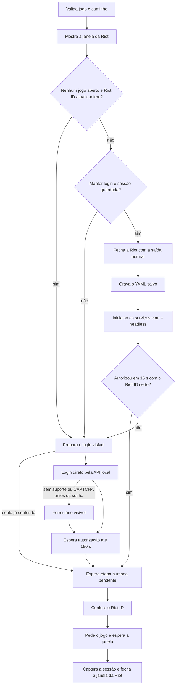

# signInFlow

> Sequência de login e abertura do jogo, montada pelo [[riotClient]] e chamada pelo [[signInService]].

## Responsabilidade

Decide a ordem das etapas: reaproveitar a sessão atual, restaurar a sessão salva em segundo plano ou preparar o login visível, autenticar, verificar o Riot ID, pedir o jogo, esperar a janela dele e fechar a janela da Riot.

Não conhece Windows nem Electron. Toda operação real chega pelo objeto `io`. Não fala HTTP, não mexe em janelas e não grava sessões no [[store]]: devolve `result.session` para quem chamou.

## API pública

| Export | Tipo | Descrição |
|---|---|---|
| `createSignInFlow(io)` | função | Recebe as dependências e retorna `signIn(options)`. |
| `signIn(options)` | função async | Executa o fluxo. Retorna `result` ou lança erro com `err.sessionRejected`; atenção nativa pendente também marca `err.needsAttention` e `err.nativeClient`. |

**`io`:** `detectClientPath`, `closeEverything`, `readSettingsYaml`, `writeSettingsYaml`, `hasPersistedLogin`, `stripPersistedLogin`, `sameRiotId`, `sessionState`, `readAuthenticationState`, `isAuthorized`, `authorization` (padrão: `'yes'` com `isAuthorized()`, senão `'unknown'`), `activeRiotId`, `localApi`, `launchProduct`, `requestLaunch`, `typeCredentials`, `authenticate`, `windows` (só `reveal`, `gameWindow` e `closeClient`), `runningGames`, `openVisibleInterface`, `closeGames`, `now` (padrão `Date.now`), `sleep`.

**`options`:** `account`, `session` (valor ou função), `hasSavedSession`, `game` (`lol`, `tft`, `val`, `riot`), `clientPath`, `remember = true`, `status`, `log`, `onClosed`, `onRejected`, `signal`.

**`result`:** `{ riotId, gameStarted, clientOpened, session, usedSavedSession, reusedCurrentSession, sessionRejected }`.

## Dependências

- Usa: só o que vem em `io`. Na prática: [[riotClient]], [[riotAuthentication]], [[riotProcess]], [[riotInterface]], [[windowController]], [[login.ps1]].
- Usado por: [[riotClient]] (monta e exporta `signIn`), chamado por [[signInService]].
- Visão de ponta a ponta: [[Fluxo de login]].

## Etapas do fluxo

1. **Validação.** `game` fora de `lol`, `tft`, `val`, `riot` falha antes de tocar em processos. Sem `RiotClientServices.exe`, falha com "Riot Client not found".
2. **Mostra a Riot.** `windows.reveal()`. Se falhar, nada é fechado nem iniciado.
3. **Reaproveita a sessão atual.** Só se nenhum jogo está aberto. Se há estado de sessão, `isAuthorized()` e o Riot ID ativo (8 s) é o da conta, marca `reusedCurrentSession` e não autentica de novo.
4. **Escolhe o caminho.** Com `remember`, `hasSavedSession === true` e sem reaproveitar, segue a restauração em segundo plano (etapas 5 a 7). Senão, vai direto ao login visível (etapa 8).
5. **Restaura a sessão salva.** Fecha tudo com `closeEverything` (saída normal), chama `onClosed(closed)` e só então lê `session`. Se a sessão tem login lembrado, grava o YAML e o guarda como `restoredYaml`. Senão, se o YAML deixado tem login lembrado, grava a versão sem ele (`stripPersistedLogin`).
6. **Reinício `--headless`.** `launchProduct(exe)` sem jogo. Espera até 45 s por um estado de sessão. Senão: "The Riot Client did not start".
7. **Confere a sessão restaurada.** Espera `isAuthorized` por 15 s, sem esperar desafio, porque não há janela para o usuário resolvê-lo. Riot ID igual: `usedSavedSession`. Riot ID diferente: `sessionRejected` e `onRejected()`, que apaga a cópia errada antes de a Riot fechar. Sem autorização: `sessionRejected`. Nos dois casos de recusa, segue para a etapa 8.
8. **Prepara o login visível.** Outra conta conectada é fechada com a saída normal (`closeEverything`, `onClosed` e o login lembrado tirado do YAML); senão, jogos abertos são fechados (`closeGames`). Abre a interface oficial (sobe a Riot visível se não houver serviço). Com a conta já conferida na etapa 3, para aqui. Depois lê `authorization()`: `'yes'` fecha a Riot de novo e reabre; ainda `'yes'` falha com "Could not sign out the previous account". `'no'` com um login pela metade (`multifactor` ou `error`) faz `DELETE /rso-auth/v1/session`.
9. **Login direto pela API.** `authenticate(account, signal, { remember })`. `supported` precisa ser booleano; senão, erro "invalid response". Com `needsAttention`, avisa 2FA ou verificação de segurança.
10. **Formulário visível.** Se `supported` é `false` ou `requiresNativeForm` é `true`, mostra "Entrando na conta…" com `nativeClient` e chama `typeCredentials(request, signal, log)` com usuário, senha e `remember`; o [[login.ps1]] sempre clica em entrar. Registra o estado `remember:` devolvido.
11. **Espera autorização.** Até 180 s. MFA/CAPTCHA depois do formulário revela uma vez a janela que recebeu a senha. Se essa atenção continuar pendente no fim, o erro orienta concluir a etapa na Riot e tentar Jogar de novo.
12. **2FA/CAPTCHA pós-autorização.** Se `authState()` ainda mostra etapa humana, espera mais 180 s.
13. **Verifica a conta.** Lê o Riot ID (8 s). Ausente ou diferente da conta: erro.
14. **Só a Riot.** Com `game: 'riot'`, guarda a sessão, abre a interface se ela ainda não abriu, chama `windows.reveal()` e devolve `clientOpened: true`.
15. **Pede o jogo e espera a janela.** Testa uma vez se o jogo já está pronto; senão, `requestLaunch(game, log)`. Até 180 s depois do último pedido aceito, a cada 1 s. Pronto exige processo do jogo e `windows.gameWindow(game)`. Após 40 s avisa demora ou atualização. Sem janela: "The game did not open". HTTP 424 `launch_failed_product_not_up_to_date` mostra "Waiting for the … update to finish…" (com `signedIn`, sem pedir atenção), repete o pedido a cada 15 s e espera até 20 min desde o primeiro pedido.
16. **Captura a sessão e fecha a Riot.** Espera até 6 s por um YAML com login lembrado diferente de `restoredYaml` e o põe em `result.session`. Chama `windows.closeClient()` e marca `gameStarted`.

Em erro: se o formulário foi usado, a autenticação não terminou, não há atenção pendente e a operação não foi cancelada, consulta uma vez o estado sanitizado; MFA/CAPTCHA pendente revela a janela. Com atenção pendente e sem cancelamento, anexa `needsAttention: true` e `nativeClient: true` ao erro, mesmo se a revelação falhou. Sempre copia `sessionRejected` para o erro e relança. A Riot fica aberta.

## Invariantes e decisões

- **Só login visível.** Desde 2026-11-07 ([[ADR-028 Modo antigo removido]]), saíram as opções `hide`, `closeClient`, `releaseAfterLaunch` e `visibleLogin`, o monitor de ocultação (`hide`, `conceal`, `park`, `assertHealthy`, `drainIncidents`), a espera de até 180 s por um desafio numa sessão restaurada e o atalho que reaproveitava o backend desconectado. Tudo isso era do login escondido do modo antigo, que o [[main]] não pedia mais. O fluxo só chama `reveal`, `gameWindow` e `closeClient` do [[windowController]]. O comportamento do app não mudou: o login visível já era o único em uso.
- **Sem `dryRun`.** Saiu no mesmo dia, junto com o `submit` do pedido de digitação: só os testes o usavam, e ele ainda fechava o cliente, reescrevia o YAML e digitava sem enviar.
- **Mensagens apontam para a janela da Riot.** Desde 2026-11-07 as mensagens em inglês não citam mais o botão "Show Riot Client", que era da janela antiga. Dizem para olhar ou abrir a janela da Riot, como as traduções do [[language]] já diziam.
- **`riot`: só entrar na conta.** Desde 2026-11-04, a pedido do usuário, `game: 'riot'` faz o login igual aos outros (sessão salva, formulário, verificações da Riot) e confere o Riot ID. Depois guarda a sessão, deixa a Riot à vista e devolve `clientOpened: true` com `gameStarted: false`, sem `requestLaunch`, sem esperar janela de jogo e sem fechar a janela do cliente. Um Riot ID diferente falha antes de mostrar o cliente. Jogos abertos continuam sendo fechados antes do login, porque a troca de conta os derruba.
- **Jogo desatualizado espera a atualização e é pedido de novo.** Quando o League ou o VALORANT precisa de atualização, o Riot recusa o pedido com HTTP 424 `launch_failed_product_not_up_to_date` e não abre o jogo sozinho depois (log real de 2026-11-04 12:36). Enquanto `requestLaunch` devolve esse código, o fluxo repete o pedido a cada `RELAUNCH_INTERVAL_MS` (15 s), até `GAME_UPDATE_TIMEOUT_MS` (20 min), sem o aviso de demora. Quando um pedido é aceito, o prazo de 180 s e o aviso de 40 s passam a contar dele. Qualquer outra recusa mantém um único pedido e o prazo de 180 s. Ainda não exercitado no Riot real.
- **Tolerância de 12 s para a checagem automática da Riot.** Logo depois que o formulário envia a senha, o autenticador passa alguns segundos em `challenge` enquanto a Riot faz a própria checagem invisível. `authState` ignora `challenge`/CAPTCHA por `AUTOMATIC_CHECK_GRACE_MS` (12 s) depois do envio. Se a checagem continua, o aviso aparece e a janela é revelada. 2FA não tem tolerância. Desde 2026-11-04.
- **"Manter login" (`remember`, padrão `true`).** Desligado, o fluxo não lê nem restaura a sessão salva, pede `remember: false` ao [[riotAuthentication]] e ao [[login.ps1]] e devolve `session: null`, sem esperar o YAML. Desde 2026-11-04.
- **Status depois da autorização levam `signedIn: true`.** A partir de "Signed in. Preparing the game…", todos os `status` informam `signedIn`. O [[riotOverlay]] usa isso para esconder os cartões assim que a conta entra.
- **Trocar de conta sem `DELETE`.** Outra conta conectada é fechada com a saída normal, `onClosed` recebe o que ela gravou e o login lembrado é tirado do YAML antes de a interface abrir. O log registra "closed the other signed-in account without signing it out". O `DELETE /rso-auth/v1/session` só acontece com `'no'` e um login pela metade na tela (`multifactor` ou `error`), nunca com `'yes'`, `'unknown'` ou uma verificação de segurança (`challenge`). Desde 2026-11-06 ([[ADR-020 Riot conectada é encerrada quando fica sem jogo]]); antes, a outra conta recebia o `DELETE`, o que encerrava a sessão dela no servidor.
- **Sessão salva entra em segundo plano.** Desde 2026-11-06 ([[ADR-019 Sessão salva por conta no modo cartões]]): a Riot fecha com a saída normal (para gravar os tokens novos), o YAML da conta é gravado e só os serviços sobem. Ninguém digita e nenhuma janela precisa de foco. Com `game: 'riot'`, a interface oficial só abre depois da restauração. Conferido no Riot real em 2026-11-06: a sessão guardada pelo [[sessionKeeper]] autorizou em 0,5 s, e uma sessão velha foi recusada em 15 s e caiu no formulário visível.
- **Só a sessão renovada é capturada.** O `refresh_token` restaurado é de uso único. O YAML que o próprio fluxo escreveu (`restoredYaml`) já foi consumido, então a etapa 16 só aceita um arquivo diferente dele. A versão nova pode chegar depois do fim do login; o [[sessionKeeper]] guarda cada regravação da Riot. Desde 2026-11-06.
- **A janela da Riot fecha só depois da janela do jogo.** Erro ou cancelamento conserva a Riot aberta, com o formulário à vista.
- **Fluxo isolado de Windows e Electron.** Assim os caminhos de falha, cancelamento e troca de conta podem ser testados com segurança.
- **Cancelamento responsivo.** `pause` dorme em fatias de 100 ms e chama `check()` em cada uma, inclusive durante atualizações. `check()` lança "Sign-in cancelled".
- **Gravações aguardadas.** As gravações do YAML são aguardadas antes de a Riot subir, desde a troca atômica do [[riotClient]] (2026-11-06).
- **Ler a sessão só depois do encerramento.** O encerramento grava os tokens renovados. Ler antes perderia a atualização.
- **O reinício só inicia serviços.** Nunca incluir um jogo antes de verificar a identidade, mesmo restaurando um token que parece válido.
- **CAPTCHA antes da senha roda no renderer da Riot.** É a primeira submissão, nunca uma nova tentativa de senha.
- **Autorização RSO não basta.** Ela pode existir enquanto a sessão do jogador ainda pede consentimento ou outra verificação. A etapa 12 espera essa verificação.
- **Desafio nativo precisa aparecer.** MFA/CAPTCHA depois do formulário revela uma vez a janela oficial existente, sem iniciar outro renderer nem reenviar a senha.
- **Falha logo depois do formulário não apaga um desafio recém-criado.** O `catch` consulta uma vez o estado sanitizado. MFA/CAPTCHA pendente tenta revelar a janela original e conserva as flags de recuperação, mesmo se a revelação falhar; o erro original permanece. Cancelamento e falhas posteriores à autenticação não fazem essa consulta.
- **Não gastar tempo com produto que não foi pedido.** Antes do pedido há um único teste. Um produto já rodando ainda precisa mostrar a janela real.
- **Sessão não atrasa o jogo.** A gravação do login lembrado pode vir depois da autorização. Ela não pode atrasar o pedido do jogo.
- **Atraso do jogo não é desafio de autenticação.** O aviso de jogo demorando não marca pendência nativa. Aviso de login lento não revela a janela automaticamente.
- **Erros de autenticação viram mensagens fixas.** `auth_failure` → "Wrong username or password"; `rate_limited` → "Too many attempts, wait a few minutes"; outros → "Riot sign-in error: <código>". Os códigos já vêm filtrados por [[riotAuthentication]].
- **Avisos sem repetição.** `attention()` só emite `status` quando o texto muda e marca `nativeClient` se o formulário foi usado. Após 35 s sem aviso, `awaitAuthorization` avisa a demora.

## Testes

`test/riot/signInFlow.test.js` usa fakes e relógio simulado. O fixture padrão restaura uma sessão guardada; `directFixture` parte da Riot desconectada e `restoreFixture` da restauração recusada. Cobre: a interface oficial aberta e a janela da Riot fechada só depois da janela do jogo; o fluxo usando só `reveal`, `gameWindow` e `closeClient`; Riot que não aparece parando antes de tudo; restauração em segundo plano sem interface nem digitação, recusada ou de outra conta caindo no formulário visível; captura só da sessão renovada; outra conta fechada com a saída normal, nunca com `DELETE`, e falha quando ela continua conectada; limpeza só de 2FA ou erro pendente; ordem encerrar → `onClosed` → ler sessão; reaproveitamento da sessão atual; login direto nos três jogos sem reiniciar; erros do login direto sem digitação; CAPTCHA antes da senha com uma única digitação; revelação única do desafio, preservação depois de timeout ou de falha da revelação, recuperação de MFA depois de uma falha logo após o formulário; cancelamentos; janela do jogo ausente; jogo desatualizado; sessão gravada com atraso; "Manter login" desligado; o pedido de digitação só com usuário, senha e `remember`.

Fora: tempos reais do Riot e a integração com o [[riotClient]] verdadeiro.

## Pontos de atenção

- **Sessão restaurada com verificação é recusada.** Uma sessão que pede 2FA ou CAPTCHA não autoriza em 15 s e cai no formulário visível. A espera pelo desafio era do login escondido.
- **Falha transitória aborta o login.** `authState()` usa `readAuthenticationState`, que propaga erros da API local. É fail-closed de propósito; ver [[Limitações conhecidas]].
- **Tempos fixos.** 45 s, 15 s, 180 s, 8 s e 6 s, além de 12 s de tolerância, 15 s entre pedidos e 20 min para a atualização do jogo. Uma atualização que o Riot não sinaliza com 424 ainda precisa caber em 180 s.
- Mudanças nas rotas ou estados da Riot afetam este fluxo: [[Atualização do Riot Client]], [[Backlog]].
