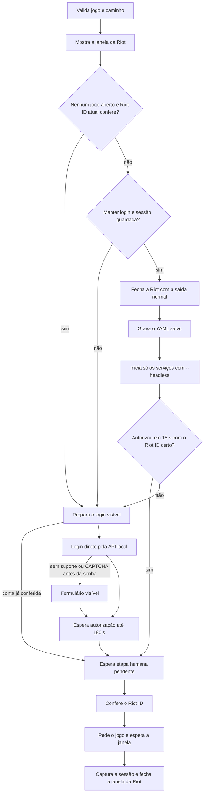

# signInFlow

> Sequência de login e abertura do jogo, montada pelo [[riotClient]] e chamada pelo [[signInService]].

## Responsabilidade

Decide a ordem das etapas: reaproveitar a sessão atual, restaurar a sessão salva em segundo plano ou preparar o login visível, autenticar, verificar o Riot ID, pedir o jogo, esperar a janela dele e fechar a janela da Riot.

Não conhece o Windows. Toda operação real chega pela trait `SignInIo`. Não fala HTTP, não mexe em janelas e não grava sessões no [[store]]: devolve a sessão no resultado para quem chamou.

## API pública

| Item | Tipo | Descrição |
|---|---|---|
| `sign_in(io, pedido)` | função | Executa o fluxo. Devolve `SignInOutcome` ou um erro; o erro leva `session_rejected` e, com atenção nativa pendente, `needs_attention` e `native_client` |
| `GAMES` | constante | `lol`, `tft`, `val` e `riot` |
| `AUTOMATIC_CHECK_GRACE_MS`, `GAME_OPEN_TIMEOUT_MS`, `GAME_UPDATE_TIMEOUT_MS`, `RELAUNCH_INTERVAL_MS` | constantes | 12 s, 180 s, 20 min e 15 s |

**`SignInIo`** (estende a `RiotProbe` do [[riotState]]): `detect_client_path`, `close_everything`, `read_settings_yaml`, `write_settings_yaml`, `has_persisted_login`, `strip_persisted_login`, `same_riot_id`, `read_authentication_state`, `is_authorized`, `active_riot_id`, `local_api`, `launch_product`, `request_launch`, `type_credentials`, `authenticate`, `reveal`, `game_window`, `close_client_window`, `open_visible_interface`, `close_games`, `now` e `sleep`.

**`SignInRequest`:** `account`, `session` (função), `has_saved_session`, `game`, `client_path`, `remember`, `status`, `log`, `on_closed`, `on_rejected` e `cancel`.

**`SignInOutcome`:** `riot_id`, `game_started`, `client_opened`, `session`, `used_saved_session`, `reused_current_session` e `session_rejected`.

## Dependências

- Usa: só o que vem pela `SignInIo`. Na prática, o [[riotClient]] a implementa com [[riotAuthentication]], [[riotProcess]], [[riotInterface]], [[windowController]] e [[loginForm]].
- Usado por: [[riotClient]] (`sign_in`), chamado pelo [[signInService]].
- Visão de ponta a ponta: [[Fluxo de login]].

## Etapas do fluxo

1. **Validação.** Um jogo fora de `GAMES` falha antes de tocar em processos. Sem `RiotClientServices.exe`, falha com "Riot Client not found".
2. **Mostra a Riot.** `reveal()`. Se falhar, nada é fechado nem iniciado.
3. **Reaproveita a sessão atual.** Uma olhada do [[riotState]]: só se nenhum jogo está aberto. Se os serviços respondem (`Ready`), a conta é `Yes` e o Riot ID ativo (8 s) é o da conta, marca `reused_current_session` e não autentica de novo.
4. **Escolhe o caminho.** Com `remember`, `has_saved_session` e sem reaproveitar, segue a restauração em segundo plano (etapas 5 a 7). Senão, vai direto ao login visível (etapa 8).
5. **Restaura a sessão salva.** Fecha tudo com `close_everything` (saída normal), chama `on_closed` e só então lê `session`. Se a sessão tem login lembrado, grava o YAML e o guarda como o restaurado. Senão, se o YAML deixado tem login lembrado, grava a versão sem ele (`strip_persisted_login`).
6. **Reinício `--headless`.** `launch_product` sem jogo. Espera até 45 s por um estado de sessão. Senão: "The Riot Client did not start".
7. **Confere a sessão restaurada.** Espera `is_authorized` por 15 s, sem esperar desafio, porque não há janela para o usuário resolvê-lo. Riot ID igual: `used_saved_session`. Riot ID diferente: `session_rejected` e `on_rejected`, que apaga a cópia errada antes de a Riot fechar. Sem autorização: `session_rejected`. Nos dois casos de recusa, segue para a etapa 8.
8. **Prepara o login visível.** Outra conta conectada é fechada com a saída normal (`close_everything`, `on_closed` e o login lembrado tirado do YAML); senão, jogos abertos são fechados (`close_games`). Abre a interface oficial (sobe a Riot visível se não houver serviço). Com a conta já conferida na etapa 3, para aqui. Depois lê a autorização: `Yes` fecha a Riot de novo e reabre; ainda `Yes` falha com "Could not sign out the previous account". `No` com um login pela metade (`multifactor` ou `error`) faz `DELETE /rso-auth/v1/session`.
9. **Login direto pela API.** `authenticate(conta, cancel, remember)`. Sem resposta válida, erro "invalid response". Com pedido de atenção, avisa 2FA ou verificação de segurança.
10. **Formulário visível.** Se a rota não tem suporte ou pede o formulário nativo, mostra "Signing in…" com `nativeClient` e chama `type_credentials` com usuário, senha e `remember`; o [[loginForm]] sempre clica em entrar. Registra o estado `remember:` devolvido.
11. **Espera autorização.** Até 180 s. MFA/CAPTCHA depois do formulário revela uma vez a janela que recebeu a senha. Se essa atenção continuar pendente no fim, o erro orienta concluir a etapa na Riot e tentar Jogar de novo.
12. **2FA/CAPTCHA pós-autorização.** Se o estado de autenticação ainda mostra etapa humana, espera mais 180 s.
13. **Verifica a conta.** Lê o Riot ID (8 s). Ausente ou diferente da conta: erro.
14. **Só a Riot.** Com `riot`, guarda a sessão, abre a interface se ela ainda não abriu, chama `reveal()` e devolve `client_opened`.
15. **Pede o jogo e espera a janela.** Testa uma vez se o jogo já está pronto; senão, `request_launch`. Até 180 s depois do último pedido aceito, a cada 1 s. Pronto exige processo do jogo e `game_window`. Após 40 s avisa demora ou atualização (`SLOW_GAME`, sem pedir atenção). Sem janela: "The game did not open". HTTP 424 `launch_failed_product_not_up_to_date` mostra "Waiting for the … update to finish…" (com `signedIn`, sem pedir atenção), repete o pedido a cada 15 s e espera até 20 min desde o primeiro pedido.
16. **Captura a sessão e fecha a Riot.** Com a janela do jogo pronta, manda "Game opened" (etapa `done`). Depois espera até 6 s por um YAML com login lembrado diferente do restaurado e o põe na sessão do resultado. Chama `close_client_window` e marca `game_started`.

Em erro: se o formulário foi usado, a autenticação não terminou, não há atenção pendente e a operação não foi cancelada, consulta uma vez o estado sanitizado; MFA/CAPTCHA pendente revela a janela. Com atenção pendente e sem cancelamento, marca `needs_attention` e `native_client` no erro, mesmo se a revelação falhou. Sempre copia `session_rejected` para o erro e o devolve. A Riot fica aberta.

## Invariantes e decisões

- **Jogo recusado pela Riot mostra a Riot (2026-11-25, 2.30.1, [[ADR-053 Etapas do login na tela até o jogo abrir]]).** Relato do usuário na 2.30.0: "meu lol nao abrir". O `sign-in.log` mostrou o pedido do jogo recusado com HTTP 464 `eula_not_accepted`: a Riot queria que os termos do League fossem aceitos de novo, e isso só aparece na janela dela. Com o Eclipse cobrindo a Riot até o jogo abrir, o usuário não via o pedido, e o login falhou depois de 180 s com "The game did not open". Agora, quando o pedido do jogo volta com HTTP 400 ou mais (menos 423 e o jogo desatualizado, que tem fluxo próprio), o fluxo manda um status com `needsAttention` e `signedIn` na etapa `launch` (`GAME_TERMS` para `eula_not_accepted`, `LAUNCH_REFUSED` para o resto), abre a janela da Riot se ainda não estava aberta (sessão salva) e a mostra, uma vez só, sem repetir o pedido. Segue esperando a janela do jogo até o prazo normal: o usuário aceita os termos e clica em Jogar na Riot, e o login termina em "Game opened". Se os termos nunca forem aceitos, o erro diz "Accept the game terms in the Riot Client, then try Play again". Nesse caso o aviso de demora não aparece.
- **`eula_not_accepted` logo depois do login é perguntado de novo (2026-11-26, 2.32.2).** Relato do usuário: a conta entrou, o LoL não abriu e o Eclipse sumiu, sem nenhum pedido de termos na Riot. O log mostrou a recusa 464 `eula_not_accepted` 2 s depois do login, e 38 s depois outro Jogar da mesma conta foi aceito sem o usuário aceitar nada: a recusa era passageira. Agora, por até `TERMS_GRACE_MS` (20 s) desde o primeiro pedido, o fluxo repete o pedido a cada `TERMS_RETRY_MS` (3 s) sem mostrar a Riot; se um deles for aceito, o prazo do jogo conta a partir dele. Só se a recusa durar os 20 s a Riot é mostrada, como na 2.30.1, e aí o Eclipse para de pedir, para não abrir o jogo duas vezes quando o usuário clicar em Jogar na Riot. Não conferido na Riot real.
- **Cada status diz a etapa (2026-11-25, 2.30.0, [[ADR-053 Etapas do login na tela até o jogo abrir]]).** `StatusDetails` ganhou `step` (`Step`: `Prepare`, `SignIn`, `Verify`, `Launch`, `Done`; códigos em `STEPS`). Fechar a Riot, subir os serviços e preparar o formulário são `prepare`; sessão salva, API local, formulário e todo pedido de atenção são `sign_in`; "Signed in. Preparing the game…" é `verify`; abrir, atualizar e demorar são `launch`; "Game opened" e "Riot Client opened" são `done`. Uma sessão salva recusada prepara o formulário ainda em `sign_in`, para a lista não andar para trás. "Game opened" agora sai assim que a janela do jogo fica pronta, antes de guardar a sessão e fechar a janela da Riot, e só uma vez. Pedido do usuário: ver a lista de etapas do login até o jogo abrir.
- **Conta conectada não espera CAPTCHA do formulário (2026-11-21, [[ADR-042 CAPTCHA do formulário não bloqueia conta autorizada]]).** O reaproveitamento da conta atual expirava em 180 s quando o [[riotAuthentication]] via o hCaptcha do formulário do próximo login. A correção ficou no [[riotAuthentication]]; o fluxo continua relendo o estado depois de autorizar e esperando verificações reais da sessão do jogador.
- **Fonte do aviso no log (2026-11-21).** Quando o fluxo mostra "A Riot ainda não terminou o login", grava no `sign-in.log` "Riot reported an unfinished sign-in (…)" com a fonte do [[riotAuthentication]] (`authenticator captcha: …`, `authenticator type: other`, `player session: …` ou `source unavailable`). Uma linha por fonte diferente, não a cada consulta. Serve para achar a causa do login que travou com a conta já conectada ([[Laboratório de velocidade do login]]); o comportamento não mudou.
- **Verificação só com sinal concreto (2026-11-19).** Pedido do usuário: um login demorou, a Riot mostrou um erro genérico de serviço, e o Eclipse avisou "conclua a verificação" sem verificação nenhuma na tela. No `sign-in.log` daquele dia, o aviso saiu 13 s depois da senha, logo após os 12 s de tolerância, e 24 s depois o serviço da Riot parou de responder. O estado `challenge` não prova uma verificação: ele aparece durante a checagem invisível normal (o objeto `captcha` do formulário), com telas que o Eclipse não conhece e com estados novos da sessão do jogador. Agora só dois sinais têm nome: 2FA (`multifactor`) e CAPTCHA recusado pela Riot (`captcha_not_allowed`, ou o motivo `security_check` do login em segundo plano). Qualquer outro `challenge`, depois da tolerância, mostra "A Riot ainda não terminou o login. Confira a tela da Riot, caso ela precise de você" e revela a janela do mesmo jeito. O tempo esgotado sem sinal confirmado diz "O login expirou. Abra o Riot Client para ver o que aconteceu", não "a verificação expirou". O login continua falhando fechado: nada abre o jogo com `challenge` pendente.
- **Cinco jogos (2026-11-19, [[ADR-038 TFT, 2XKO e Runeterra no Eclipse]]).** `GAMES` aceita `lol`, `tft`, `val`, `2xko`, `lor` e `riot`. `launch_game` espera o processo do próprio jogo (`RunningGames::game`) e a janela dele, e os textos "Abrindo o … em segundo plano" e "Aguardando a atualização do …" saem de `starting_status` e `updating_status`, com tradução no [[language]].
- **Só login visível.** Desde 2026-11-07 ([[ADR-028 Modo antigo removido]]), saíram as opções `hide`, `closeClient`, `releaseAfterLaunch` e `visibleLogin`, o monitor de ocultação (`hide`, `conceal`, `park`, `assertHealthy`, `drainIncidents`), a espera de até 180 s por um desafio numa sessão restaurada e o atalho que reaproveitava o backend desconectado. Tudo isso era do login escondido do modo antigo, que o [[main]] não pedia mais. O fluxo só pede ao [[windowController]] `reveal`, `game_window` e o fechamento da janela do cliente. O comportamento do app não mudou: o login visível já era o único em uso.
- **Sem `dryRun`.** Saiu no mesmo dia, junto com o `submit` do pedido de digitação: só os testes o usavam, e ele ainda fechava o cliente, reescrevia o YAML e digitava sem enviar.
- **Mensagens apontam para a janela da Riot.** Desde 2026-11-07 as mensagens em inglês não citam mais o botão "Show Riot Client", que era da janela antiga. Dizem para olhar ou abrir a janela da Riot, como as traduções do [[language]] já diziam.
- **Começo pelo [[riotState]].** Desde 2026-11-07 ([[ADR-029 Estado da Riot definido num lugar só]]), a pergunta "onde a Riot está" no começo do login (jogo aberto, serviços respondendo, conta conectada) vem de uma olhada do [[riotState]], montado com as consultas da `SignInIo`. Uma conta `Unknown` nunca é reaproveitada. As esperas depois do começo (serviços subindo, conta entrando depois da digitação, janela do jogo) são o progresso do próprio fluxo e continuam nas consultas diretas.
- **Status sempre em inglês.** Até 2026-11-07 dois status eram escritos em português ("Preparando o login no Riot Client…" e "Entrando na conta…"). Agora saem em inglês, como os outros, e o [[language]] traduz na saída; o `sign-in.log` fica todo em inglês.
- **`riot`: só entrar na conta.** Desde 2026-11-04, a pedido do usuário, `riot` faz o login igual aos outros (sessão salva, formulário, verificações da Riot) e confere o Riot ID. Depois guarda a sessão, deixa a Riot à vista e devolve `client_opened` sem `game_started`, sem `request_launch`, sem esperar janela de jogo e sem fechar a janela do cliente. Um Riot ID diferente falha antes de mostrar o cliente. Jogos abertos continuam sendo fechados antes do login, porque a troca de conta os derruba.
- **Jogo desatualizado espera a atualização e é pedido de novo.** Quando o League ou o VALORANT precisa de atualização, o Riot recusa o pedido com HTTP 424 `launch_failed_product_not_up_to_date` e não abre o jogo sozinho depois (log real de 2026-11-04 12:36). Enquanto `request_launch` devolve esse código, o fluxo repete o pedido a cada `RELAUNCH_INTERVAL_MS` (15 s), até `GAME_UPDATE_TIMEOUT_MS` (20 min), sem o aviso de demora. Quando um pedido é aceito, o prazo de 180 s e o aviso de 40 s passam a contar dele. Qualquer outra recusa mantém um único pedido e o prazo de 180 s. Ainda não exercitado no Riot real.
- **Tolerância de 12 s para a checagem automática da Riot.** Logo depois que o formulário envia a senha, o autenticador passa alguns segundos em `challenge` enquanto a Riot faz a própria checagem invisível. A leitura do estado ignora `challenge`/CAPTCHA por `AUTOMATIC_CHECK_GRACE_MS` (12 s) depois do envio. Se a checagem continua, o aviso aparece e a janela é revelada. 2FA não tem tolerância. Desde 2026-11-04.
- **"Manter login" (`remember`, padrão `true`).** Desligado, o fluxo não lê nem restaura a sessão salva, pede para não lembrar ao [[riotAuthentication]] e ao [[loginForm]] e devolve a sessão vazia, sem esperar o YAML. Desde 2026-11-04.
- **Status depois da autorização levam `signedIn: true`.** A partir de "Signed in. Preparing the game…", todos os `status` informam `signedIn`. O [[riotOverlay]] usa isso para esconder os cartões assim que a conta entra.
- **Trocar de conta sem `DELETE`.** Outra conta conectada é fechada com a saída normal, `on_closed` recebe o que ela gravou e o login lembrado é tirado do YAML antes de a interface abrir. O log registra "closed the other signed-in account without signing it out". O `DELETE /rso-auth/v1/session` só acontece com `'no'` e um login pela metade na tela (`multifactor` ou `error`), nunca com `Yes`, `Unknown` ou uma verificação de segurança (`challenge`). Desde 2026-11-06 ([[ADR-020 Riot conectada é encerrada quando fica sem jogo]]); antes, a outra conta recebia o `DELETE`, o que encerrava a sessão dela no servidor.
- **Sessão salva entra em segundo plano.** Desde 2026-11-06 ([[ADR-019 Sessão salva por conta no modo cartões]]): a Riot fecha com a saída normal (para gravar os tokens novos), o YAML da conta é gravado e só os serviços sobem. Ninguém digita e nenhuma janela precisa de foco. Com `riot`, a interface oficial só abre depois da restauração. Conferido no Riot real em 2026-11-06: a sessão guardada pelo [[sessionKeeper]] autorizou em 0,5 s, e uma sessão velha foi recusada em 15 s e caiu no formulário visível.
- **Só a sessão renovada é capturada.** O `refresh_token` restaurado é de uso único. O YAML que o próprio fluxo escreveu já foi consumido, então a etapa 16 só aceita um arquivo diferente dele. A versão nova pode chegar depois do fim do login; o [[sessionKeeper]] guarda cada regravação da Riot. Desde 2026-11-06.
- **A janela da Riot fecha só depois da janela do jogo.** Erro ou cancelamento conserva a Riot aberta, com o formulário à vista.
- **Fluxo isolado do Windows.** Tudo chega pela `SignInIo`, com relógio e espera dela. Assim os caminhos de falha, cancelamento e troca de conta podem ser testados com um relógio falso.
- **Cancelamento responsivo.** As esperas dormem em fatias de 100 ms e conferem o cancelamento em cada uma, inclusive durante atualizações. Cancelado, o fluxo falha com "Sign-in cancelled".
- **Gravações aguardadas.** As gravações do YAML são aguardadas antes de a Riot subir, desde a troca atômica do [[riotClient]] (2026-11-06).
- **Ler a sessão só depois do encerramento.** O encerramento grava os tokens renovados. Ler antes perderia a atualização.
- **O reinício só inicia serviços.** Nunca incluir um jogo antes de verificar a identidade, mesmo restaurando um token que parece válido.
- **CAPTCHA antes da senha roda na janela da Riot.** É a primeira submissão, nunca uma nova tentativa de senha.
- **Autorização RSO não basta.** Ela pode existir enquanto a sessão do jogador ainda pede consentimento ou outra verificação. A etapa 12 espera essa verificação.
- **Desafio nativo precisa aparecer.** MFA/CAPTCHA depois do formulário revela uma vez a janela oficial existente, sem iniciar outro renderer nem reenviar a senha.
- **Falha logo depois do formulário não apaga um desafio recém-criado.** O tratamento do erro consulta uma vez o estado sanitizado. MFA/CAPTCHA pendente tenta revelar a janela original e conserva as flags de recuperação, mesmo se a revelação falhar; o erro original permanece. Cancelamento e falhas posteriores à autenticação não fazem essa consulta.
- **Não gastar tempo com produto que não foi pedido.** Antes do pedido há um único teste. Um produto já rodando ainda precisa mostrar a janela real.
- **Sessão não atrasa o jogo.** A gravação do login lembrado pode vir depois da autorização. Ela não pode atrasar o pedido do jogo.
- **Atraso do jogo não é desafio de autenticação.** O aviso de jogo demorando não marca pendência nativa e, desde a 2.30.0, nem atenção: é o status `SLOW_GAME` com `signedIn`, na etapa `launch`, e não tira o Eclipse da frente. Aviso de login lento não revela a janela automaticamente.
- **Como o formulário foi preenchido vai para o log.** Desde 2026-11-21 ([[ADR-043 Preenchimento do login por UI Automation]]), "credentials entered (…)" começa com `input:uia` ou `input:keys` quando o [[loginForm]] diz qual caminho usou, sempre de `INPUT_METHODS`; qualquer outra linha `input:` é ignorada. Depois vem o estado da caixa, como antes.
- **Erros de autenticação viram mensagens fixas.** `auth_failure` → "Wrong username or password"; `rate_limited` → "Too many attempts, wait a few minutes"; outros → "Riot sign-in error: <código>". Os códigos já vêm filtrados por [[riotAuthentication]].
- **Avisos sem repetição.** O aviso de atenção só sai quando o texto muda e marca `nativeClient` se o formulário foi usado. Após 35 s sem aviso, a espera da autorização avisa a demora.
- **Herdado do Electron.** Os 61 cenários do teste do Electron foram portados um a um, e três mutações de propósito no fluxo (sem as marcas de atenção, sem esperar a verificação do jogador e sem a carência da checagem automática) fizeram testes falharem.

## Testes

Também: a etapa de cada status e a ordem `prepare` → `sign_in` → `verify` → `launch` → `done` no login visível, com sessão salva, com sessão recusada e só com a Riot; a conta reaproveitada pulando `sign_in`; "Game opened" uma vez e antes de fechar a janela da Riot; pedidos de atenção sempre em `sign_in`; o jogo demorando sem pedir atenção.

`src-tauri/tests/riot/sign_in_flow.rs` usa fakes e relógio falso. Cobre: a interface oficial aberta e a janela da Riot fechada só depois da janela do jogo; Riot que não aparece parando antes de tudo; restauração em segundo plano sem interface nem digitação, recusada ou de outra conta caindo no formulário visível; captura só da sessão renovada; outra conta fechada com a saída normal, nunca com `DELETE`, e falha quando ela continua conectada; limpeza só de 2FA ou erro pendente; ordem encerrar → `on_closed` → ler sessão; reaproveitamento da sessão atual; login direto nos três jogos sem reiniciar; erros do login direto sem digitação; CAPTCHA antes da senha com uma única digitação; revelação única do desafio, preservação depois de timeout ou de falha da revelação, recuperação de MFA depois de uma falha logo após o formulário; cancelamentos; a fonte do aviso de login não terminado no log, uma vez por fonte; o caminho do preenchimento no log só de lista fixa; janela do jogo ausente; jogo desatualizado; sessão gravada com atraso; "Manter login" desligado; o pedido de digitação só com usuário, senha e `remember`.

Fora: tempos reais da Riot e a integração com o [[riotClient]] verdadeiro.

## Pontos de atenção

- **Sessão restaurada com verificação é recusada.** Uma sessão que pede 2FA ou CAPTCHA não autoriza em 15 s e cai no formulário visível. A espera pelo desafio era do login escondido.
- **Falha transitória aborta o login.** A leitura do estado de autenticação propaga erros da API local. É fail-closed de propósito; ver [[Limitações conhecidas]].
- **Tempos fixos.** 45 s, 15 s, 180 s, 8 s e 6 s, além de 12 s de tolerância, 15 s entre pedidos e 20 min para a atualização do jogo. Uma atualização que o Riot não sinaliza com 424 ainda precisa caber em 180 s.
- Mudanças nas rotas ou estados da Riot afetam este fluxo: [[Atualização do Riot Client]], [[Backlog]].
