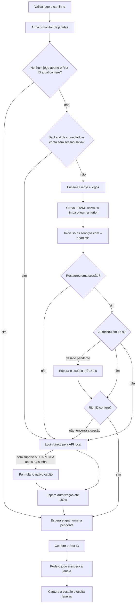

# signInFlow

> Sequência de login e abertura do jogo, montada pelo [[riotClient]] e chamada pelo [[signInService]].

## Responsabilidade

Decide a ordem das etapas: reaproveitar a sessão atual, restaurar a sessão salva, reiniciar o cliente, autenticar, verificar o Riot ID, pedir o jogo e esperar a janela dele.

Não conhece Windows nem Electron. Toda operação real chega pelo objeto `io`. Não fala HTTP, não mexe em janelas e não grava sessões no [[store]]: devolve `result.session` para quem chamou.

## API pública

| Export | Tipo | Descrição |
|---|---|---|
| `createSignInFlow(io)` | função | Recebe as dependências e retorna `signIn(options)`. |
| `signIn(options)` | função async | Executa o fluxo. Retorna `result` ou lança erro com `err.sessionRejected`. |

**`io`:** `detectClientPath`, `closeEverything`, `readSettingsYaml`, `writeSettingsYaml`, `hasPersistedLogin`, `stripPersistedLogin`, `sameRiotId`, `sessionState`, `readAuthenticationState`, `isAuthorized`, `activeRiotId`, `localApi`, `launchProduct`, `requestLaunch`, `typeCredentials`, `authenticate`, `windows`, `runningGames`, `now` (padrão `Date.now`), `sleep`.

**`options`:** `account`, `session` (valor ou função), `hasSavedSession`, `game` (`lol`, `tft`, `val`), `clientPath`, `hide = true`, `closeClient = true`, `dryRun = false`, `status`, `log`, `onClosed`, `signal`.

**`result`:** `{ riotId, gameStarted, session, usedSavedSession, reusedCurrentSession, sessionRejected }`.

## Dependências

- Usa: só o que vem em `io`. Na prática: [[riotClient]], [[riotAuthentication]], [[riotProcess]], [[windowController]], [[login.ps1]].
- Usado por: [[riotClient]] (monta e exporta `signIn`), chamado por [[signInService]].
- Visão de ponta a ponta: [[Fluxo de login]].

## Etapas do fluxo

1. **Validação.** `game` fora de `lol`, `tft`, `val` falha antes de tocar em processos. Sem `RiotClientServices.exe`, falha com "Riot Client not found".
2. **Arma o monitor.** Com `hide`: `windows.conceal()` se existe `authenticate`, senão `windows.hide()`. Marca `guardArmed`. Sem `hide`: `windows.reveal()`.
3. **Reaproveita a sessão atual.** Só se nenhum jogo está aberto. Se há estado de sessão, `isAuthorized()` e o Riot ID ativo (8 s) é o da conta, pula para a etapa 11 (`reusedCurrentSession`). Outra conta conectada segue para a etapa 5.
4. **Reaproveita o backend desconectado.** Também só sem jogo aberto. Se o estado é `auth` sem erro, `hasSavedSession === false` e existe `authenticate`, pula o reinício e vai para o login direto.
5. **Restaura a sessão salva.** Fecha tudo com `closeEverything`, chama `onClosed(closed)` e só então lê `session`. Se a sessão tem login lembrado, grava o YAML. Senão, se o YAML deixado tem login lembrado, grava a versão sem ele (`stripPersistedLogin`).
6. **Reinício `--headless`.** `launchProduct(exe)` sem jogo. Espera até 45 s por um estado de sessão. Senão: "The Riot Client did not start".
7. **Confere a sessão restaurada.** Espera `isAuthorized` por 15 s. Com 2FA ou CAPTCHA pendente, espera o usuário por até 180 s; o tempo esgotado é erro, sem digitar a senha. Riot ID diferente: `DELETE /rso-auth/v1/session`, espera desconectar (15 s) e marca `sessionRejected`. Sem autorização: `sessionRejected`. Nos dois casos segue para a etapa 8. Riot ID igual: `usedSavedSession` e pula para a etapa 11.
8. **Login direto pela API.** `authenticate(account, signal)`. `supported` precisa ser booleano; senão, erro "invalid response". Com `needsAttention`, avisa 2FA ou verificação de segurança.
9. **Fallback para a interface nativa escondida.** Se `supported` é `false` ou `requiresNativeForm` é `true`. Com `hide` e `authenticate`, troca para `windows.hide()` e chama `typeCredentials(request, signal, log)` com `remember: true` e `submit: !dryRun`. O `log` permite registrar como a interface foi aberta ([[riotInterface]]). Registra o estado `remember:` devolvido.
10. **Espera autorização.** Até 180 s. Senão: "Sign-in timed out".
11. **2FA/CAPTCHA pós-autorização.** Se `authState()` ainda mostra etapa humana, espera mais 180 s.
12. **Verifica a conta.** Com `hide`, `windows.conceal()` de novo. Lê o Riot ID (8 s). Ausente ou diferente da conta: erro.
13. **Pedido de abertura do jogo.** Testa uma vez se o jogo já está pronto. Se não, chama `requestLaunch(game, log)`.
14. **Espera pela janela do jogo.** Até 180 s, a cada 1 s. Pronto exige processo do jogo e `windows.gameWindow(game)`. Após 40 s avisa demora ou atualização. Sem janela: "The game did not open".
15. **Captura a sessão.** Espera até 6 s por um YAML com login lembrado e o põe em `result.session`. Com `hide` ou `closeClient`, `windows.conceal()`. Marca `gameStarted`.

Em erro: com `hide`, chama `windows.conceal()` (falha só vai ao log), copia `sessionRejected` para o erro e relança.

## Invariantes e decisões

- **Fluxo isolado de Windows e Electron.** Assim os caminhos de falha, cancelamento e troca de conta podem ser testados com segurança.
- **Cancelamento responsivo.** `pause` dorme em fatias de 100 ms e chama `check()` em cada uma, inclusive durante atualizações. `check()` lança "Sign-in cancelled" e, com o monitor armado, chama `windows.assertHealthy()`.
- **Armar o monitor antes de fechar ou reabrir.** O encerramento pode recriar uma janela do cliente. Se o monitor não arma, nada é fechado nem iniciado.
- **Tela de login limpa e sem sessão salva não reinicia nada.** Não é preciso trocar configurações nem reiniciar o backend.
- **Ler a sessão só depois do encerramento.** O encerramento grava os tokens renovados. Ler antes perderia a atualização.
- **O reinício só inicia serviços.** Nunca incluir um jogo antes de verificar a identidade, mesmo restaurando um token que parece válido.
- **Sessão salva também pode pedir verificação.** Nunca digitar credenciais sobre um desafio pendente, mesmo que ele expire.
- **CAPTCHA antes da senha roda no renderer da Riot.** É a primeira submissão, nunca uma nova tentativa de senha.
- **Autorização RSO não basta.** Ela pode existir enquanto a sessão do jogador ainda pede consentimento ou outra verificação. A interface nativa termina isso.
- **Depois do 2FA, esconder de novo.** Se o usuário abriu o cliente para o 2FA, as janelas são ocultadas após a conclusão.
- **Não gastar tempo com produto que não foi pedido.** Antes do pedido há um único teste. Um produto já rodando ainda precisa mostrar a janela real.
- **Sessão não atrasa o jogo.** A gravação do login lembrado pode vir depois da autorização. Ela não pode atrasar o pedido do jogo nem exigir reabrir a janela de login.
- **Nunca derrubar o monitor ao abrir o jogo.** A Riot pode criar outra janela durante o carregamento ou após uma partida. Só se ocultam as janelas Riot.
- **Falha comum não mostra a tela de login.** O `catch` oculta as janelas em vez de revelá-las.
- **Erros de autenticação viram mensagens fixas.** `auth_failure` → "Wrong username or password"; `rate_limited` → "Too many attempts, wait a few minutes"; outros → "Riot sign-in error: <código>". Os códigos já vêm filtrados por [[riotAuthentication]].
- **Avisos sem repetição.** `attention()` só emite `status` quando o texto muda e marca `nativeClient` se o formulário nativo foi usado. Após 35 s sem aviso, `awaitAuthorization` avisa a demora.

## Testes

`test/riot/signInFlow.test.js` usa fakes e relógio simulado. Cobre: ordem encerrar → `onClosed` → ler sessão; sessão expirada com fallback de digitação; monitor indisponível ou perdido; 2FA e CAPTCHA sem digitação; sessão salva de outra conta; reaproveitamento da sessão atual e do backend desconectado para os três jogos; erros do login direto sem fallback; CAPTCHA antes da senha com uma única digitação; janela do jogo ausente; cancelamento em várias etapas; sessão gravada com atraso; `dryRun`.

Fora: tempos reais do Riot e a integração com o [[riotClient]] verdadeiro.

## Pontos de atenção

- **`closeClient` não fecha o cliente.** Só dispara o `conceal()` final. Com `hide = false` e `closeClient = true`, isso inicia o monitor e oculta as janelas que o usuário pediu para ver.
- **`dryRun` tem efeitos.** Não envia login direto nem pede o jogo. Mas, conforme o caminho, fecha o cliente, reescreve o YAML, reinicia o backend e digita usuário e senha no formulário nativo (sem enviar). Nenhum chamador de produção passa `dryRun`.
- **Falha transitória aborta o login.** `authState()` usa `readAuthenticationState`, que propaga erros da API local. Um erro momentâneo durante a espera encerra a tentativa. É fail-closed de propósito; ver [[Limitações conhecidas]].
- **Tempos fixos.** 45 s, 15 s, 180 s, 8 s e 6 s. Atualizações longas do jogo podem passar de 180 s.
- Mudanças nas rotas ou estados da Riot afetam este fluxo: [[Atualização do Riot Client]], [[Backlog]].
