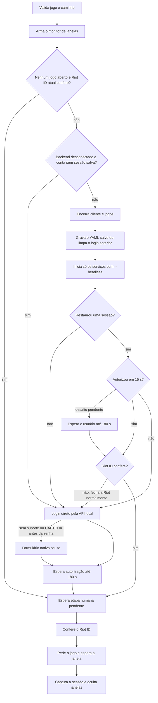

# signInFlow

> Sequência de login e abertura do jogo, montada pelo [[riotClient]] e chamada pelo [[signInService]].

## Responsabilidade

Decide a ordem das etapas: reaproveitar a sessão atual, restaurar a sessão salva, reiniciar o cliente, autenticar, verificar o Riot ID, pedir o jogo e esperar a janela dele.

Não conhece Windows nem Electron. Toda operação real chega pelo objeto `io`. Não fala HTTP, não mexe em janelas e não grava sessões no [[store]]: devolve `result.session` para quem chamou.

## API pública

| Export | Tipo | Descrição |
|---|---|---|
| `createSignInFlow(io)` | função | Recebe as dependências e retorna `signIn(options)`. |
| `signIn(options)` | função async | Executa o fluxo. Retorna `result` ou lança erro com `err.sessionRejected`; atenção nativa pendente também marca `err.needsAttention` e `err.nativeClient`. |

**`io`:** `detectClientPath`, `closeEverything`, `readSettingsYaml`, `writeSettingsYaml`, `hasPersistedLogin`, `stripPersistedLogin`, `sameRiotId`, `sessionState`, `readAuthenticationState`, `isAuthorized`, `authorization` (padrão: `'yes'` com `isAuthorized()`, senão `'unknown'`), `activeRiotId`, `localApi`, `launchProduct`, `requestLaunch`, `typeCredentials`, `authenticate`, `windows`, `runningGames`, `openVisibleInterface`, `closeGames`, `now` (padrão `Date.now`), `sleep`.

**`options`:** `account`, `session` (valor ou função), `hasSavedSession`, `game` (`lol`, `tft`, `val`), `clientPath`, `hide = true`, `closeClient = true`, `dryRun = false`, `releaseAfterLaunch = false`, `visibleLogin = false`, `remember = true`, `status`, `log`, `onClosed`, `onRejected`, `signal`.

**`result`:** `{ riotId, gameStarted, session, usedSavedSession, reusedCurrentSession, sessionRejected }`.

## Dependências

- Usa: só o que vem em `io`. Na prática: [[riotClient]], [[riotAuthentication]], [[riotProcess]], [[windowController]], [[login.ps1]].
- Usado por: [[riotClient]] (monta e exporta `signIn`), chamado por [[signInService]].
- Visão de ponta a ponta: [[Fluxo de login]].

## Etapas do fluxo

1. **Validação.** `game` fora de `lol`, `tft`, `val` falha antes de tocar em processos. Sem `RiotClientServices.exe`, falha com "Riot Client not found".
2. **Arma o monitor.** Com `hide`: `windows.conceal()` se existe `authenticate`, senão `windows.hide()`. Marca `guardArmed`. Sem `hide`: `windows.reveal()`.
3. **Reaproveita a sessão atual.** Só se nenhum jogo está aberto. Se há estado de sessão, `isAuthorized()` e o Riot ID ativo (8 s) é o da conta, pula para a etapa 11 (`reusedCurrentSession`). Outra conta conectada segue para a etapa 5.
4. **Reaproveita o backend desconectado.** Também só sem jogo aberto. Se o estado é `auth` sem erro, `hasSavedSession === false` e existe `authenticate`, pula o reinício e vai para o login direto.
5. **Restaura a sessão salva.** Fecha tudo com `closeEverything`, chama `onClosed(closed)` e só então lê `session`. Se a sessão tem login lembrado, grava o YAML e o guarda como `restoredYaml`. Senão, se o YAML deixado tem login lembrado, grava a versão sem ele (`stripPersistedLogin`).
6. **Reinício `--headless`.** `launchProduct(exe)` sem jogo. Espera até 45 s por um estado de sessão. Senão: "The Riot Client did not start".
7. **Confere a sessão restaurada.** Espera `isAuthorized` por 15 s. Com 2FA ou CAPTCHA pendente, espera o usuário por até 180 s; o tempo esgotado é erro, sem digitar a senha. Riot ID diferente: marca `sessionRejected` e chama `onRejected()`, que apaga a cópia errada antes de a Riot fechar. Fora do modo cartões, fecha a Riot com a saída normal (`closeEverything`, `onClosed` e o login lembrado tirado do YAML) e sobe os serviços de novo; no modo cartões, quem fecha é o login visível. Até 2026-11-06 era `DELETE /rso-auth/v1/session`, que encerrava no servidor a sessão da outra conta. Sem autorização: `sessionRejected`. Nos dois casos segue para a etapa 8. Riot ID igual: `usedSavedSession` e pula para a etapa 11.
8. **Login direto pela API.** `authenticate(account, signal)`. `supported` precisa ser booleano; senão, erro "invalid response". Com `needsAttention`, avisa 2FA ou verificação de segurança.
9. **Fallback para a interface nativa escondida.** Se `supported` é `false` ou `requiresNativeForm` é `true`. Com `hide` e `authenticate`, troca para `windows.hide()` (o monitor pode cair e ser reerguido durante a digitação, ver [[windowController]]) e chama `typeCredentials(request, signal, log)` com `remember: true` e `submit: !dryRun`. O `log` permite registrar como a interface foi aberta ([[riotInterface]]). Registra o estado `remember:` devolvido.
10. **Espera autorização.** Até 180 s. MFA/CAPTCHA após o formulário nativo revela uma vez a janela que já recebeu a senha. Se essa atenção continuar pendente no fim, o erro orienta concluir a etapa no Riot e tentar Play novamente; a janela permanece disponível.
11. **2FA/CAPTCHA pós-autorização.** Se `authState()` ainda mostra etapa humana, espera mais 180 s.
12. **Verifica a conta.** Com `hide`, `windows.conceal()` de novo. Lê o Riot ID (8 s). Ausente ou diferente da conta: erro.
13. **Pedido de abertura do jogo.** Testa uma vez se o jogo já está pronto. Se não, chama `requestLaunch(game, log)`.
14. **Espera pela janela do jogo.** Até 180 s depois do último pedido aceito, a cada 1 s. Pronto exige processo do jogo e `windows.gameWindow(game)`. Após 40 s avisa demora ou atualização. Sem janela: "The game did not open". Se o pedido voltou HTTP 424 `launch_failed_product_not_up_to_date`, mostra "Waiting for the … update to finish…" (com `signedIn`, sem pedir atenção), repete o pedido a cada 15 s e espera até 20 min desde o primeiro pedido. Sem atualização concluída: "The game update did not finish in time".
15. **Captura a sessão.** Espera até 6 s por um YAML com login lembrado diferente de `restoredYaml` e o põe em `result.session`. Sem versão nova depois de uma restauração, o log registra "Riot has not renewed the restored session yet" e `result.session` fica `null`. Com `hide` ou `closeClient`, `windows.conceal()`. Marca `gameStarted`.

Em erro: com `hide`, chama `windows.conceal()` (falha só vai ao log), exceto quando há atenção de autenticação nativa pendente e a operação não foi cancelada. Nesse caso preserva a janela e anexa `needsAttention: true` e `nativeClient: true` ao erro, mesmo se a tentativa de revelá-la falhou. Sempre copia `sessionRejected` para o erro e relança.

## Invariantes e decisões

- **`riot`: só entrar na conta.** Desde 2026-11-04, a pedido do usuário, `game: 'riot'` faz o login igual aos outros (sessão salva, serviço em segundo plano ou formulário nativo, verificações da Riot) e confere o Riot ID. Depois guarda a sessão como de costume, chama `windows.reveal()` para deixar o Riot Client à vista e devolve `clientOpened: true` com `gameStarted: false`, sem `requestLaunch`, sem esperar janela de jogo e sem fechar a janela do cliente. Um Riot ID diferente falha antes de mostrar o cliente, como nos jogos. Jogos abertos continuam sendo fechados antes do login, porque a troca de conta os derruba.
- **Jogo desatualizado espera a atualização e é pedido de novo.** Quando o League ou o VALORANT precisa de atualização, o Riot recusa o pedido com HTTP 424 `launch_failed_product_not_up_to_date` e não abre o jogo sozinho depois. Antes, o fluxo esperava 180 s pela janela e falhava mesmo com a atualização concluída (log real de 2026-11-04 12:36). Agora, enquanto `requestLaunch` devolve esse código, o fluxo repete o pedido a cada `RELAUNCH_INTERVAL_MS` (15 s), até `GAME_UPDATE_TIMEOUT_MS` (20 min). Nesse período não emite o aviso de demora. Quando um pedido é aceito, o prazo de 180 s e o aviso de 40 s passam a contar dele. Qualquer outra recusa mantém um único pedido e o prazo de 180 s. Adicionado em 2026-11-04; ainda não exercitado no Riot real.
- **Tolerância de 12 s para a checagem automática da Riot.** Logo depois que o formulário nativo envia a senha, o autenticador passa alguns segundos em `challenge` enquanto a Riot faz a própria checagem invisível, e a conta entra sozinha. Antes, isso virava na hora o aviso "Riot needs a security check" (faixa nos cartões e balão na bandeja) em quase todo login real, 2 a 3 s antes do "Signed in". Agora `authState` ignora `challenge`/CAPTCHA por `AUTOMATIC_CHECK_GRACE_MS` (12 s) depois do envio. Se a checagem continua depois disso, o aviso aparece e a janela é revelada como antes. 2FA não tem tolerância: aparece na hora. Adicionado em 2026-11-04.
- **"Manter login" (`remember`, padrão `true`).** Desligado, o fluxo não lê nem restaura a sessão salva, pede `remember: false` ao [[riotAuthentication]] e ao [[login.ps1]] e devolve `session: null`, sem esperar o YAML. Adicionado em 2026-11-04.
- **Status depois da autorização levam `signedIn: true`.** A partir de "Signed in. Preparing the game…", todos os `status` informam `signedIn`. O [[riotOverlay]] usa isso para esconder os cartões assim que a conta entra, antes de o jogo abrir.
- **Login visível no modo sobreposto.** `visibleLogin` força `hide: false` e não usa o monitor de ocultação. Sem sessão salva (ou com "Manter login" desligado), garante a interface oficial e reutiliza o backend. Se outra conta está conectada, a Riot é fechada com a saída normal (`closeEverything`), `onClosed` recebe o que ela gravou e o login lembrado é tirado do YAML antes de a interface abrir. O log registra "closed the other signed-in account without signing it out". Com a interface aberta, o fluxo lê o estado da conta (`authorization`). Se a Riot entrou sozinha numa conta (`'yes'`), ela é fechada do mesmo jeito e a interface reabre. Se continuar conectada, o login falha com "Could not sign out the previous account", sem `DELETE`. O `DELETE /rso-auth/v1/session` só acontece com `'no'` e um login pela metade na tela (`multifactor` ou `error`, de uma tentativa anterior), para o formulário voltar limpo. Nunca com `'yes'`, com `'unknown'` ou com uma verificação de segurança (`challenge`). Até 2026-11-06, esse `DELETE` vinha sempre, por garantia. Desde 2026-11-06 ([[ADR-020 Riot conectada é encerrada quando fica sem jogo]]); antes, a outra conta recebia o `DELETE` direto, o que encerrava a sessão dela no servidor. Sessão atual só é reaproveitada após verificar identidade. Jogos previamente abertos são fechados apenas no caminho já confirmado pelo renderer. Após janela do jogo confirmada e captura de sessão, chama `windows.closeClient()`. Erro ou cancelamento conserva a janela visível. [[ADR-010 Login visível com progresso]] substitui o fluxo de ocultação nesse modo.
- **Sessão salva no modo cartões entra em segundo plano.** Desde 2026-11-06 ([[ADR-019 Sessão salva por conta no modo cartões]]), com `visibleLogin`, `remember` e `hasSavedSession === true`, o fluxo usa as etapas 5 a 7: fecha a Riot com `closeEverything` (saída normal, para ela gravar os tokens novos), grava o YAML da conta e sobe só os serviços, sem interface. Ninguém digita e nenhuma janela precisa de foco. Nesse modo, uma sessão que não autoriza em 15 s é recusada na hora, sem esperar desafio, porque não há janela para o usuário resolvê-lo. Recusa ou Riot ID diferente marcam `sessionRejected` e caem no login visível: a Riot conectada a outra conta é fechada com a saída normal, a interface oficial abre e o formulário nativo segue como antes. Com `game: 'riot'`, a interface oficial só abre depois da restauração. Conferido no Riot real em 2026-11-06: a sessão guardada pelo [[sessionKeeper]] autorizou em 0,5 s, e uma sessão velha foi recusada em 15 s e caiu no formulário visível.
- **Só a sessão renovada é capturada.** O `refresh_token` restaurado é de uso único: a Riot o troca ao entrar. O YAML que o próprio fluxo escreveu (`restoredYaml`) já foi consumido, então a etapa 15 só aceita um arquivo diferente dele. A versão nova pode chegar depois do fim do login; o [[sessionKeeper]] guarda cada regravação da Riot. Adicionado em 2026-11-06 ([[ADR-020 Riot conectada é encerrada quando fica sem jogo]]).

- **Finalização sobreposta.** Com `releaseAfterLaunch`, depois de confirmar a janela do jogo e ocultar o cliente, chama `windows.park()` para restaurar estilos sem revelar a Riot e desarmar a ocultação. A próxima abertura oficial pode reaparecer. O modo privado conserva o monitor anterior.

- **Fluxo isolado de Windows e Electron.** Assim os caminhos de falha, cancelamento e troca de conta podem ser testados com segurança.
- **Cancelamento responsivo.** `pause` dorme em fatias de 100 ms e chama `check()` em cada uma, inclusive durante atualizações. `check()` lança "Sign-in cancelled" e, com o monitor armado, grava no log as quedas do monitor (`windows.drainIncidents()`: "window guard restarted after <código>" ou "could not be restarted after <código>") e chama `windows.assertHealthy()`. O bloco de erro também grava as quedas pendentes antes do `conceal` final. Desde 2026-10-26, `assertHealthy` só falha quando o [[windowController]] não conseguiu reerguer o monitor.
- **Armar o monitor antes de fechar ou reabrir.** O encerramento pode recriar uma janela do cliente. Se o monitor não arma, nada é fechado nem iniciado.
- **Tela de login limpa e sem sessão salva não reinicia nada.** Não é preciso trocar configurações nem reiniciar o backend.
- **Gravações aguardadas.** Desde 2026-11-06, as três gravações do YAML são aguardadas antes de a Riot subir. A gravação ficou assíncrona com a troca atômica do [[riotClient]].
- **Ler a sessão só depois do encerramento.** O encerramento grava os tokens renovados. Ler antes perderia a atualização.
- **O reinício só inicia serviços.** Nunca incluir um jogo antes de verificar a identidade, mesmo restaurando um token que parece válido.
- **Sessão salva também pode pedir verificação.** Nunca digitar credenciais sobre um desafio pendente, mesmo que ele expire.
- **CAPTCHA antes da senha roda no renderer da Riot.** É a primeira submissão, nunca uma nova tentativa de senha.
- **Autorização RSO não basta.** Ela pode existir enquanto a sessão do jogador ainda pede consentimento ou outra verificação. A interface nativa termina isso.
- **Desafio nativo precisa aparecer.** MFA/CAPTCHA após o formulário nativo revela uma vez a janela oficial existente, sem iniciar outro renderer nem reenviar a senha. Sessão salva e login direto continuam com a recuperação manual, pois não possuem um renderer nativo criado pelo fluxo.
- **Falha do monitor não pode apagar um desafio recém-criado.** Se uma falha ocorre depois de começar o formulário nativo, mas antes de concluir a autenticação, o `catch` consulta uma vez o estado sanitizado sem depender da saúde do monitor. MFA/CAPTCHA pendente tenta revelar a janela original e conserva as flags de recuperação, inclusive se a revelação falhar; o erro original permanece. Cancelamento e falhas posteriores à autenticação não fazem essa consulta.
- **Depois do 2FA, esconder de novo.** Ao concluir a autenticação, limpa a pendência antes de ocultar as janelas, verificar a identidade e pedir o jogo.
- **Não gastar tempo com produto que não foi pedido.** Antes do pedido há um único teste. Um produto já rodando ainda precisa mostrar a janela real.
- **Sessão não atrasa o jogo.** A gravação do login lembrado pode vir depois da autorização. Ela não pode atrasar o pedido do jogo nem exigir reabrir a janela de login.
- **Nunca derrubar o monitor ao abrir o jogo.** A Riot pode criar outra janela durante o carregamento ou após uma partida. Só se ocultam as janelas Riot.
- **Falha comum não mostra a tela de login.** O `catch` oculta as janelas. Atenção de autenticação nativa pendente é a exceção: timeout não esconde a tela necessária nem perde a possibilidade de recuperar o mesmo contexto pelo [[main]]. Cancelamento explícito volta a ocultar e não conserva flags de recuperação.
- **Atraso do jogo não é desafio de autenticação.** O aviso de jogo demorando não marca pendência nativa; erro posterior não mantém a janela de login aberta. Aviso de login lento preserva eventual abertura manual, mas não revela a janela automaticamente.
- **Erros de autenticação viram mensagens fixas.** `auth_failure` → "Wrong username or password"; `rate_limited` → "Too many attempts, wait a few minutes"; outros → "Riot sign-in error: <código>". Os códigos já vêm filtrados por [[riotAuthentication]].
- **Avisos sem repetição.** `attention()` só emite `status` quando o texto muda e marca `nativeClient` se o formulário nativo foi usado. Após 35 s sem aviso, `awaitAuthorization` avisa a demora.

## Testes

`test/riot/signInFlow.test.js` usa fakes e relógio simulado. Cobre: modo cartões restaurando a sessão salva sem interface nem digitação, caindo no formulário visível com sessão recusada ou de outra conta, sem reiniciar a Riot com "Manter login" desligado ou sem sessão, abrindo a interface depois da restauração em `riot`, capturando só a sessão renovada (nunca o YAML restaurado) fechando outra conta conectada com a saída normal e nunca com `DELETE` (sessão restaurada de outra conta nos dois modos, com `onRejected` antes do fechamento, e conta que a Riot restaurou sozinha), falhando sem `DELETE` quando a conta continua conectada e limpando só um 2FA ou um erro pendente com a Riot sem conta; ordem encerrar → `onClosed` → ler sessão; sessão expirada com fallback de digitação; monitor indisponível ou perdido; 2FA e CAPTCHA sem digitação; sessão salva de outra conta; reaproveitamento da sessão atual e do backend desconectado para os três jogos; erros do login direto sem fallback; CAPTCHA antes da senha com uma única digitação; revelação única do desafio nativo, preservação após timeout/falha de revelação, recuperação de MFA se o monitor falha imediatamente após digitar, inspeção de recuperação indisponível, cancelamento com ocultação e ausência de flags de autenticação no timeout do jogo; janela do jogo ausente; jogo desatualizado pedido de novo até abrir, atualização que não termina em 20 min, prazo contado do pedido aceito e recusa comum sem repetição; sessão gravada com atraso; `dryRun`.

Fora: tempos reais do Riot e a integração com o [[riotClient]] verdadeiro.

## Pontos de atenção

- **`closeClient` não fecha o cliente.** Só dispara o `conceal()` final. Com `hide = false` e `closeClient = true`, isso inicia o monitor e oculta as janelas que o usuário pediu para ver.
- **`dryRun` tem efeitos.** Não envia login direto nem pede o jogo. Mas, conforme o caminho, fecha o cliente, reescreve o YAML, reinicia o backend e digita usuário e senha no formulário nativo (sem enviar). Nenhum chamador de produção passa `dryRun`.
- **Falha transitória aborta o login.** `authState()` usa `readAuthenticationState`, que propaga erros da API local. Um erro momentâneo durante a espera encerra a tentativa. É fail-closed de propósito; ver [[Limitações conhecidas]].
- **Tempos fixos.** 45 s, 15 s, 180 s, 8 s e 6 s, além de 12 s de tolerância, 15 s entre pedidos e 20 min para a atualização do jogo. Uma atualização que o Riot não sinaliza com 424 ainda precisa caber em 180 s.
- Mudanças nas rotas ou estados da Riot afetam este fluxo: [[Atualização do Riot Client]], [[Backlog]].
